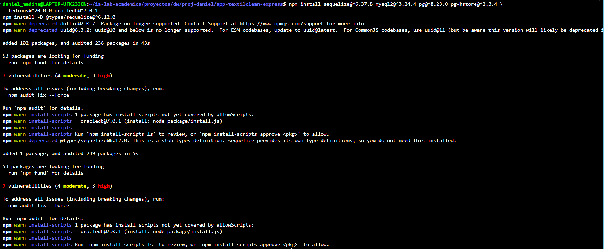
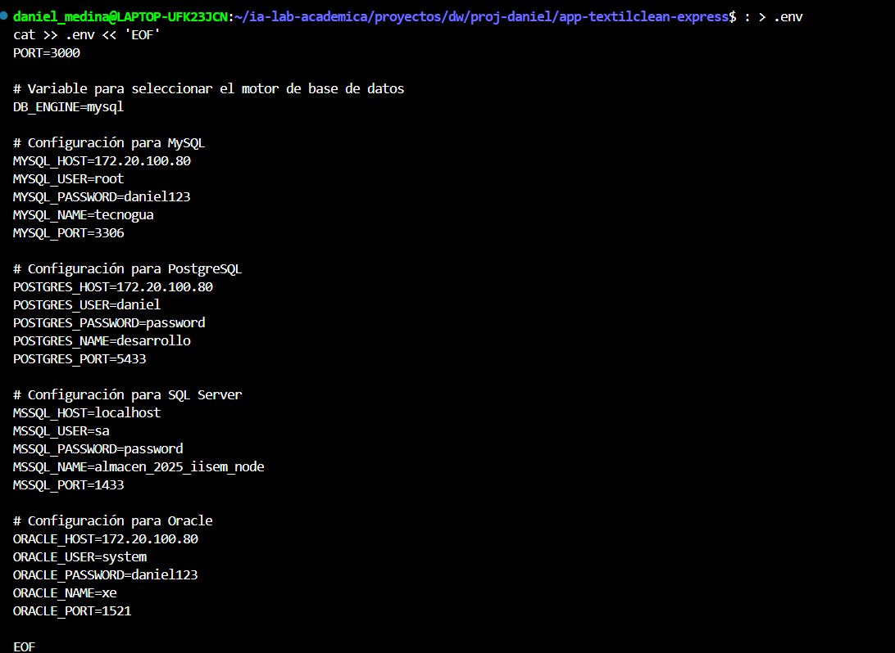
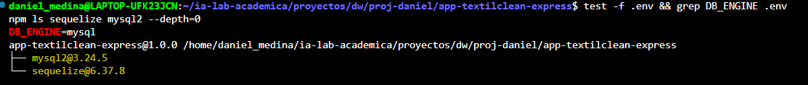
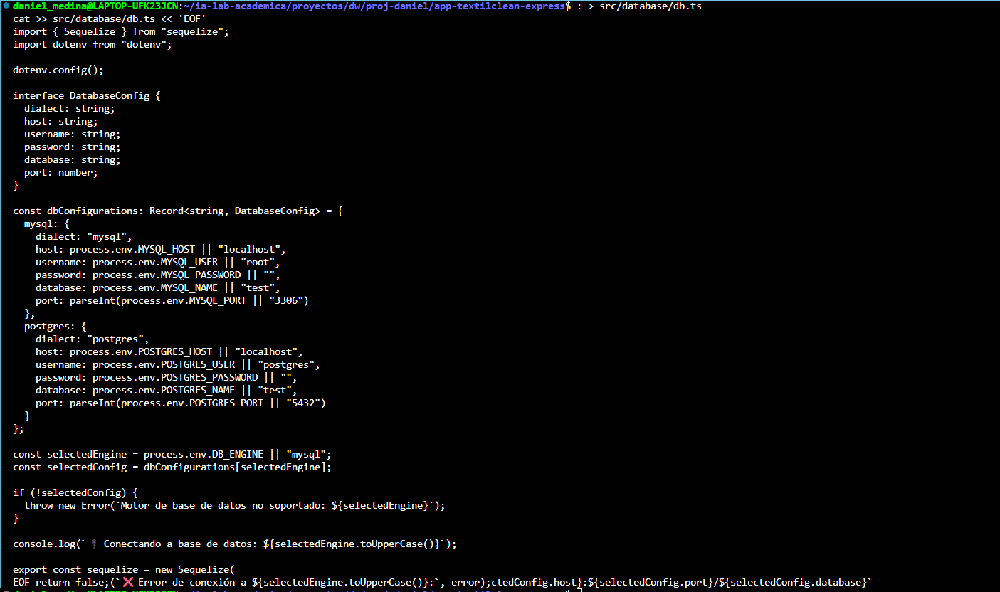
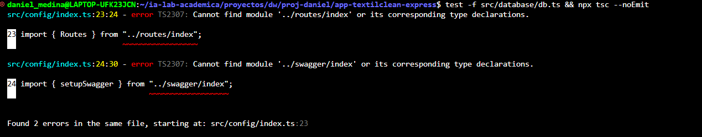
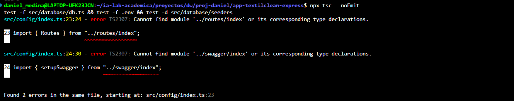
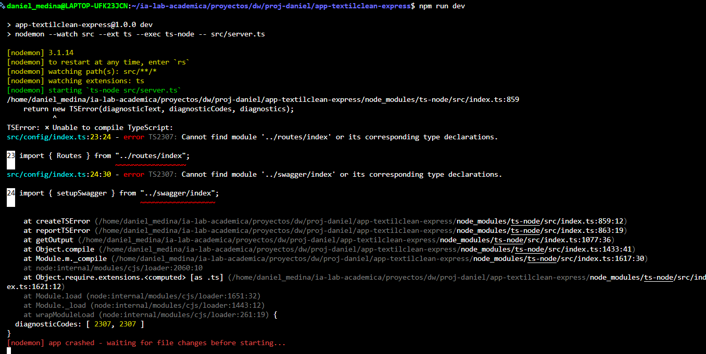

# 🛠 ISS-02 · Infraestructura de base de datos — app-textilclean-express

**Proyecto:** app-textilclean-express — Express 5 + TypeScript + Sequelize, arquitectura por features. **Fase I:** Business (sin auth ni roles). **Objetivo:** drivers + `.env` + módulo Sequelize + carpeta `seeders/`. **Bloqueado por:** ISS-01 — Esqueleto del proyecto. **Habilita:** ISS-03 — Feature Client (CRUD por capas).

------------------------------------------------------------------------

## Criterios de aceptación (ISS-02)

- [ ] 3.1 Paquetes Sequelize/drivers instalados; existe `.env` con `DB_ENGINE` y bloques de motores
- [ ] 3.2 Existe `src/database/db.ts` exportando `sequelize`, `getDatabaseInfo`, `testConnection`
- [ ] 3.3 Existe carpeta `src/database/seeders/` sin lógica implementada aún
- [ ] `npx tsc --noEmit` OK

------------------------------------------------------------------------

## 3.1 Drivers Sequelize y .env

Instala Sequelize 6 y los cuatro drivers de motor (MySQL, PostgreSQL, MSSQL, Oracle) más los `@types` de Sequelize. El driver activo se elige en tiempo de ejecución con `DB_ENGINE`.

``` bash
npm install sequelize@^6.37.8 mysql2@^3.24.4 pg@^8.23.0 pg-hstore@^2.3.4 \
  tedious@^20.0.0 oracledb@^7.0.1
npm install -D @types/sequelize@^6.12.0
```



Crea el archivo `.env` con `PORT`, `DB_ENGINE` y los bloques de configuración para los cuatro motores.

``` bash
: > .env
cat >> .env << 'EOF'
PORT=3000

# Variable para seleccionar el motor de base de datos
DB_ENGINE=mysql

# Configuración para MySQL
MYSQL_HOST=172.20.100.80
MYSQL_USER=root
MYSQL_PASSWORD=daniel123
MYSQL_NAME=tecnogua
MYSQL_PORT=3306

# Configuración para PostgreSQL
POSTGRES_HOST=172.20.100.80
POSTGRES_USER=daniel
POSTGRES_PASSWORD=password
POSTGRES_NAME=desarrollo
POSTGRES_PORT=5433

# Configuración para SQL Server
MSSQL_HOST=localhost
MSSQL_USER=sa
MSSQL_PASSWORD=password
MSSQL_NAME=almacen_2025_iisem_node
MSSQL_PORT=1433

# Configuración para Oracle
ORACLE_HOST=172.20.100.80
ORACLE_USER=system
ORACLE_PASSWORD=daniel123
ORACLE_NAME=xe
ORACLE_PORT=1521

EOF
```



Verifica que el `.env` existe y que `DB_ENGINE` está definido, y confirma que Sequelize y `mysql2` quedaron instalados.

``` bash
test -f .env && grep DB_ENGINE .env
npm ls sequelize mysql2 --depth=0 
```



> ⚠️ **Aviso:** el `.env` contiene credenciales. **No debe subirse al repositorio.** Añade `.env` a tu `.gitignore` y, si quieres versionar la plantilla, sube un `.env.example` sin valores reales.

------------------------------------------------------------------------

## 3.2 Configuración Sequelize (database/db.ts)

Crea `src/database/db.ts` con la configuración multi-motor. Exporta `sequelize` (instancia del ORM), `getDatabaseInfo` (metadatos) y `testConnection` (prueba de conexión).

``` bash
: > src/database/db.ts
cat >> src/database/db.ts << 'EOF'
import { Sequelize } from "sequelize";
import dotenv from "dotenv";

dotenv.config();

interface DatabaseConfig {
  dialect: string;
  host: string;
  username: string;
  password: string;
  database: string;
  port: number;
}

const dbConfigurations: Record<string, DatabaseConfig> = {
  mysql: {
    dialect: "mysql",
    host: process.env.MYSQL_HOST || "localhost",
    username: process.env.MYSQL_USER || "root",
    password: process.env.MYSQL_PASSWORD || "",
    database: process.env.MYSQL_NAME || "test",
    port: parseInt(process.env.MYSQL_PORT || "3306")
  },
  postgres: {
    dialect: "postgres",
    host: process.env.POSTGRES_HOST || "localhost",
    username: process.env.POSTGRES_USER || "postgres",
    password: process.env.POSTGRES_PASSWORD || "",
    database: process.env.POSTGRES_NAME || "test",
    port: parseInt(process.env.POSTGRES_PORT || "5432")
  }
};

const selectedEngine = process.env.DB_ENGINE || "mysql";
const selectedConfig = dbConfigurations[selectedEngine];

if (!selectedConfig) {
  throw new Error(`Motor de base de datos no soportado: ${selectedEngine}`);
}

console.log(`🔌 Conectando a base de datos: ${selectedEngine.toUpperCase()}`);

export const sequelize = new Sequelize(
  selectedConfig.database,
  selectedConfig.username,
  selectedConfig.password,
  {
    host: selectedConfig.host,
    port: selectedConfig.port,
    dialect: selectedConfig.dialect as any,
    logging: process.env.NODE_ENV === 'development' ? console.log : false,
    pool: {
      max: 5,
      min: 0,
      acquire: 30000,
      idle: 10000
    }
  }
);

export const getDatabaseInfo = () => {
  return {
    engine: selectedEngine,
    config: selectedConfig,
    connectionString: `${selectedConfig.dialect}://${selectedConfig.username}@${selectedConfig.host}:${selectedConfig.port}/${selectedConfig.database}`
  };
};

export const testConnection = async (): Promise<boolean> => {
  try {
    await sequelize.authenticate();
    console.log(`✅ Conexión exitosa a ${selectedEngine.toUpperCase()}`);
    return true;
  } catch (error) {
    console.error(`❌ Error de conexión a ${selectedEngine.toUpperCase()}:`, error);
    return false;
  }
};
EOF
```



Verifica que el archivo existe y que el proyecto compila (debería empezar a reducir los errores pendientes del ISS-01).

``` bash
test -f src/database/db.ts && npx tsc --noEmit
```



------------------------------------------------------------------------

## 3.3 Carpeta seeders (reservada)

Reserva la carpeta `src/database/seeders/`. La lógica de seeders (con `@faker-js/faker`, `SeedersRunner` y `counts`) llega en **ISS-04**.

``` bash
mkdir -p src/database/seeders
# opcional: touch src/database/seeders/.gitkeep
```

Verifica que la carpeta existe:

``` bash
test -d src/database/seeders && echo OK
```


------------------------------------------------------------------------

## Verificación del ISS-02

Comprueba que no hay errores de tipado y que los tres artefactos (`db.ts`, `.env`, `seeders/`) existen.

``` bash
npx tsc --noEmit
test -f src/database/db.ts && test -f .env && test -d src/database/seeders
```



------------------------------------------------------------------------

## Cierre del ISS

Levanta el servidor en modo desarrollo. Debe arrancar sin error. Detenerlo con `Ctrl+C` antes de continuar (ISS-03 reutiliza el mismo puerto y la misma base de datos).

``` bash
npm run dev
```



------------------------------------------------------------------------

## ✅ GATE de la unidad ISS-02

**Checklist de cierre:**

- [ ] `sequelize`, `mysql2`, `pg`, `pg-hstore`, `tedious` y `oracledb` instalados
- [ ] `.env` con `PORT`, `DB_ENGINE` y los bloques de los cuatro motores
- [ ] `src/database/db.ts` exporta `sequelize`, `getDatabaseInfo` y `testConnection`
- [ ] `src/database/seeders/` existe sin lógica
- [ ] `npx tsc --noEmit` OK
- [ ] `npm run dev` arranca e intenta conectar

Con todo en verde, el ISS-02 está cumplido y puedes pasar al **ISS-03 — Feature Client (CRUD por capas)**.

------------------------------------------------------------------------

**Navegación de la ruta:** ← ISS-01 · 🛠 Construir · ↑ Ruta Express · → ISS-02 · 🛠 Construir
