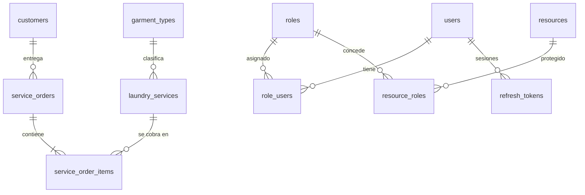

# Cierre Fase II · Auth con RBAC — TextilClean (backend completo)

## Resumen

| Elemento | Valor |
|---|---|
| Features | 12 (5 de negocio + 7 de auth: users, roles, resources, role-users, resource-roles, refresh-tokens, session) |
| Tablas | 11 (5 de negocio + 6 de auth) |
| Operaciones en Swagger | 79 (69 RBAC + 5 sesiones JWT + 5 de sesión/permisos) |
| Recursos RBAC | 69 |
| Roles | ADMIN (69 permisos), OPERATOR (17 permisos) |
| Usuarios de laboratorio | `admin / Admin123!`, `operador / Operador123!` |

## Modelo de datos completo



## Modalidades por ruta

| Modalidad | Rutas |
|---|---|
| OPEN | `POST /api/sesion/login`, `/refresh`, `/logout`, `GET /api/docs`, `/api/docs.json` |
| JWT | `GET /api/sesion/perfil`, `GET /api/permisos`, `/api/sesiones/**` |
| JWT + RBAC | `/api/clientes`, `/api/tipos-prenda`, `/api/servicios`, `/api/ordenes`, `/api/detalle-ordenes`, `/api/usuarios`, `/api/roles`, `/api/recursos`, `/api/asignaciones-rol`, `/api/concesiones-rol` |

## Qué puede hacer el operario (OPERATOR)

| Puede | No puede |
|---|---|
| Consultar clientes, prendas, servicios, órdenes y líneas | Eliminar o desactivar nada |
| Registrar clientes y órdenes | Cambiar precios ni catálogos |
| Agregar y editar líneas de una orden | Anular órdenes |
| Avanzar el estado del proceso | Administrar usuarios, roles o permisos |
| Modificar notas/fechas de una orden (PATCH) | Reemplazar órdenes completas (PUT) |

## Verificación de cierre

```bash
npm run typecheck                      # sin errores
DB_SYNC_FORCE=true npm run dev         # base limpia (luego DB_SYNC_FORCE=false)
npm run db:seed                        # 2 roles, 69 recursos, 2 usuarios, 2 asignaciones, 86 concesiones
npm run smoke                          # smoke E2E de las 3 modalidades → 🎉 en verde
```

## Criterios de cierre (DoD)

- [x] 12 features con capas `routes → controller → service → repository → model`
- [x] 11 tablas, todas del dominio TextilClean o del RBAC
- [x] 3 modalidades aplicadas por ruta
- [x] No existe entidad `Permission`: el permiso es la fila de `resource_roles`
- [x] Deny by default: sin concesión activa → 403
- [x] Access token corto (HS256, `iss`, `aud`, `exp`, `jti`); refresh opaco, hasheado, rotativo y revocable
- [x] `role_users` y `resource_roles` soportan asignar, retirar, reactivar y `reconcileRole`
- [x] Seeders deterministas con los conteos indicados
- [x] Swagger en `/api/docs` con `bearerAuth`, 401/403 y modalidades por operación
- [x] `npx tsc --noEmit` sin errores
- [x] Smoke test E2E en verde (`npm run smoke`)
