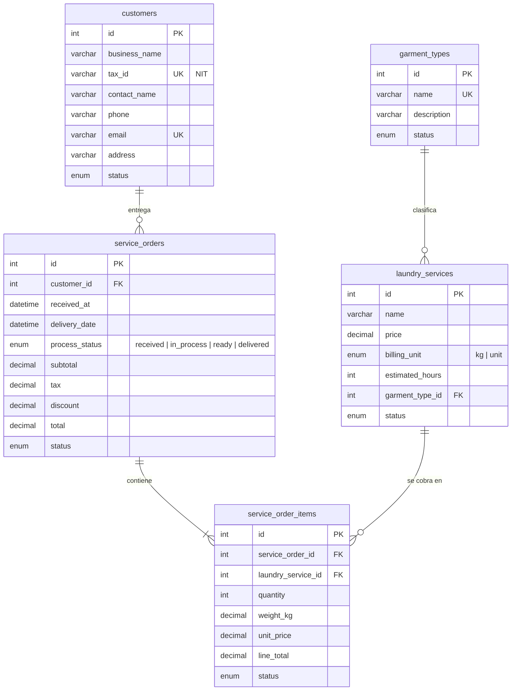

# Cierre Fase I · Business (sin auth) — TextilClean

Estado consolidado del backend al terminar ISS-00 … ISS-08.

## Modelo de datos (5 tablas)



## Features de negocio

| Feature | Ruta | Operaciones |
|---|---|---|
| customers | `/api/clientes` | CRUD + deactivate |
| garment-types | `/api/tipos-prenda` | CRUD + deactivate |
| laundry-services | `/api/servicios` | CRUD + deactivate |
| service-orders | `/api/ordenes` | CRUD + `estado` + deactivate (anular) |
| service-order-items | `/api/detalle-ordenes` | CRUD + deactivate |

Todos siguen `routes → controller → service → repository → model`.

## Verificación de cierre

```bash
npm run typecheck                      # sin errores
DB_SYNC_FORCE=true npm run dev         # recrea las 5 tablas (luego volver a false)
npm run db:seed                        # 10 clientes, 10 prendas, 20 servicios, 15 órdenes
# Swagger: http://localhost:4000/api/docs → 36 operaciones
```

Recorrido manual sugerido (archivos `.http`):

1. Crear un cliente (`customers.create.http`).
2. Consultar servicios (`laundry-services.get.http`) y elegir uno por kg y otro por unidad.
3. Crear una orden con ambas líneas (`service-orders.create.http`) y revisar los totales.
4. Agregar y editar líneas (`service-order-items.*.http`): el total de la orden cambia.
5. Avanzar el estado hasta `delivered` y comprobar que ya no se puede modificar (409).

## Criterios de cierre

- [x] 5 features de negocio con las capas completas
- [x] 5 tablas propias del dominio de lavandería (ninguna de la tienda de la guía)
- [x] Seeders deterministas/idempotentes y Swagger completo
- [x] `npx tsc --noEmit` sin errores
