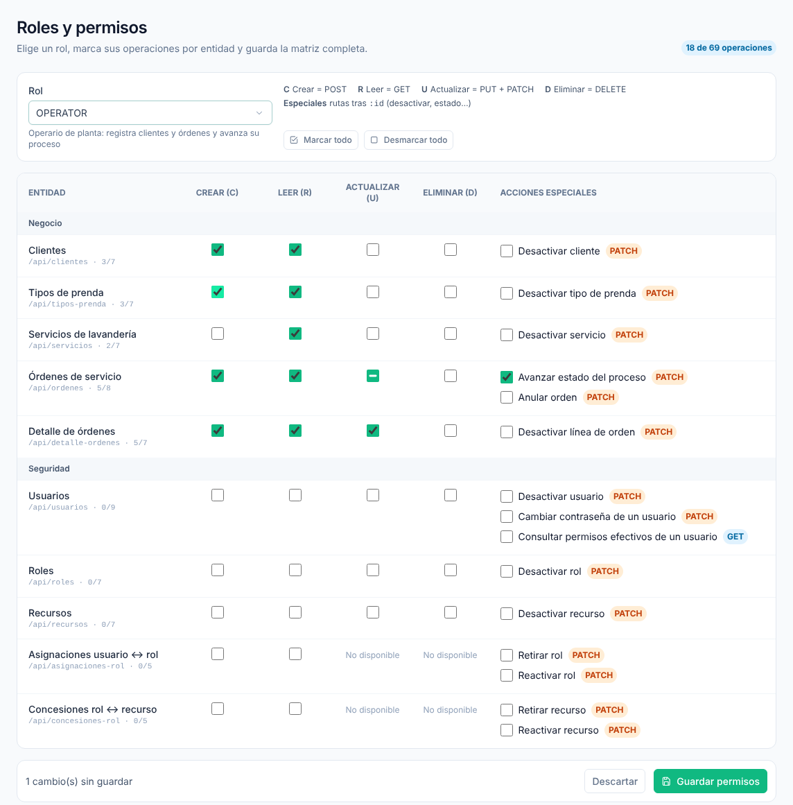

# ISS-CR-04 · Integración, pruebas y cierre — TextilClean

**Depende de:** ISS-CR-03. **Cierra** la ruta ISS-Crud (panel de roles y permisos).

## Flujo completo demostrado

```text
1. ADMIN inicia sesión y abre Seguridad → Roles y permisos (/admin/permisos).
2. El frontend carga roles y recursos (GET /api/roles, GET /api/recursos).
3. Consulta las concesiones del rol elegido (GET /api/concesiones-rol?role_id=2).
4. Desmarca «Leer Clientes» de OPERATOR (2 recursos: lista + detalle) y guarda.
5. Express valida rol y recursos (400/404/409).
6. ResourceRolesService reconcilia en una transacción (+0 / −2).
7. El frontend muestra «Cambios guardados. 15 permisos activos…» y recarga.
8. El operador recibe 403 en GET /api/clientes; al restaurar, 200.
```



En la captura, «Actualizar» de *Órdenes de servicio* aparece **parcial**:
OPERATOR tiene `PATCH /api/ordenes/:id` pero no `PUT`. «Avanzar estado del
proceso» es una acción especial con su propia casilla.

## Pruebas frontend (Vitest + HttpTestingController)

`npm test` → **26 archivos, 115 pruebas en verde** (94 previas + 21 de esta ruta).

| Suite | Casos |
|---|---|
| `features/admin/resource-roles/permission-matrix.spec.ts` | entidad por path; PUT/PATCH = Actualizar; especiales; agrupación y secciones; todos/ninguno/parcial; marcar/desmarcar grupo sin mutar; conteo de cambios; etiquetas |
| `features/admin/resource-roles/permission-matrix/permission-matrix.spec.ts` | carga con envolturas reales y solo roles activos; catálogo sin roles; cambio de rol con concesiones distintas; Leer parcial y casilla que cambia 2 IDs; guardado del conjunto completo + doble clic + recarga; guardado con lista vacía; recarga de permisos propios; error 409 visible sin éxito; respuesta sin `result` = error; guardado bloqueado durante la carga; solo lectura sin `POST`; error al cargar el catálogo |
| `core/api-contracts.spec.ts` | `reconcileRole` hace `POST { role_id, resource_ids }` y desenvuelve `result`; `list` con `HttpParams`; envolturas mal formadas → error |

```bash
npm test -- --include=src/app/features/admin/resource-roles/**/*.spec.ts
npm test
npm run build
```

## Pruebas de API e integración (backend)

| Comando | Resultado |
|---|---|
| `npm run typecheck` | ✔ |
| `npm run test:reconcile` | 12/12: alta, idempotencia, revocación, reactivación, duplicados, inexistente, inactivo, rol inválido, **rollback**, guarda de ADMIN, lista vacía, forma HTTP |
| `npm run smoke` | sección «Matriz de permisos»: 401 sin JWT, 403 con operador, 400 duplicados/inexistente/forma mixta, 404 rol, sin cambios tras entradas inválidas, 403 → 200 efectivo |
| `npm run db:seed:catalog` (×2) | catálogo de 69, 0 creados, concesiones intactas |

## E2E en navegador (Playwright + Chrome, backend y `ng serve` reales)

```text
✅ ADMIN: «Leer Clientes» marcado
✅ Asignaciones sin Actualizar muestra «No disponible»
✅ OPERATOR: Leer Clientes marcado
✅ OPERATOR: Eliminar Clientes desmarcado
✅ OPERATOR: «Cambiar estado» de órdenes marcado
✅ Estado parcial visible (ordenes:update)
✅ Cambios sin guardar = 2 (lista + detalle)
✅ Backend: OPERATOR pasó de 17 a 15 permisos
✅ Operador recibe 403 en GET /api/clientes
✅ Operador vuelve a 200 tras restaurar
✅ Rol sin permisos: matriz desmarcada sin error
✅ ADMIN sin panel → error 409 visible
✅ Operador no ve «Roles y permisos» en el menú
sin errores JS
```

La suite E2E previa (órdenes, guards, refresh, logout) se volvió a ejecutar en verde.

## Precaución con los seeders

`npm run db:seed` vuelve a dejar ADMIN y OPERATOR con la matriz por defecto y
**sobrescribe** lo configurado en este panel. En una base con permisos ajustados:

- `npm run db:seed:catalog` → solo registra rutas nuevas del catálogo.
- `npm run db:seed -- --skip-grants` → datos de prueba sin tocar `resource_roles`.

## Diagnóstico guiado

| Síntoma | Qué revisar primero |
|---|---|
| No aparecen recursos | permiso `GET /api/recursos`, envoltura `resources`, recursos activos |
| No aparecen concesiones | `role_id` de la consulta, envoltura `grants`, concesiones activas |
| Casilla parcial | la columna agrupa varios endpoints (Leer = lista + detalle; Actualizar = PUT + PATCH) |
| Guardar devuelve `400` | IDs positivos, únicos, existentes y activos |
| Guardar devuelve `403` | JWT y concesión `POST /api/concesiones-rol` |
| Guardar devuelve `409` | ADMIN quedaría sin `GET /api/roles`, `GET /api/recursos` o `GET`/`POST /api/concesiones-rol` |
| La UI permite algo que la API niega | `authorize` y el par `method + path`; la UI no autoriza |
| El permiso desapareció tras sembrar | se ejecutó `db:seed` sin `--skip-grants` |
| Recursos duplicados | `assertUniqueCatalog` y el índice `uq_resources_method_path` |

## Criterios de aceptación consolidados

- [x] Contrato del panel documentado y coherente con el backend (ISS-CR-00).
- [x] Catálogo de recursos único y sincronizado (ISS-CR-01).
- [x] Rutas protegidas por JWT y RBAC.
- [x] Reconciliación transaccional con validación de IDs (ISS-CR-02).
- [x] La matriz representa estados marcado, desmarcado y parcial (ISS-CR-03).
- [x] El frontend muestra errores y confirma el éxito solo con la respuesta del API.
- [x] Autorización comprobada con peticiones directas, no solo desde la UI.
- [x] Pruebas unitarias y compilaciones en verde.
- [x] Seeder probado en una base de pruebas y efectos documentados.
- [x] Evidencia sin tokens, contraseñas ni datos de conexión.

## Reflexión

1. **¿Por qué el backend es la autoridad final?** El navegador lo controla el
   usuario: puede saltarse Angular y llamar la API con `curl`. Solo `authorize`,
   que consulta `resource_roles` en cada petición, decide de verdad.
2. **¿Qué simplifica reconciliar la lista completa en una transacción?** El
   frontend envía un único estado final, sin ordenar altas y bajas; el backend
   calcula la diferencia, es idempotente y, si algo falla, no deja una matriz a medias.
3. **¿Por qué una casilla puede representar varios recursos?** Porque la
   autorización es por `method + path`: «Leer Clientes» son `GET /api/clientes` y
   `GET /api/clientes/:id`; «Actualizar» son `PUT` y `PATCH`.
4. **¿Qué riesgos introduce marcar todo?** Concede también la administración de
   seguridad (usuarios, roles, la propia matriz): un rol operativo podría darse
   más permisos. Por eso «Marcar todo» pide confirmación.
5. **¿Y si el backend no tuviera `resource_ids` por rol?** Habría que enviar una
   petición por casilla (conceder/retirar) sin atomicidad, o agregar un endpoint de
   reconciliación como este. TextilClean conserva ambas formas en el mismo `POST`.
