# Proceso de construcción — TextilClean Express (frontend)

Guía reproducible de la construcción del frontend `front-textilclean-express`
(Angular 22 + PrimeNG 22 + Tailwind CSS 4) sobre el backend
`app-textilclean-express` (Express 5 + TypeScript + Sequelize 6).

**Objetivo del documento:** que cualquier persona pueda volver a levantar este
sistema desde cero siguiendo los mismos pasos, con las mismas versiones y con la
evidencia de cada bloque.

---

## Cómo usar este documento

1. Los pasos están agrupados por **ISS** (unidad de trabajo) y, dentro de cada
   ISS, por **bloque**.
2. Cada bloque tiene: **qué se hace**, **comando o código**, **resultado
   esperado** y **evidencia** (captura en `docs/imagenes/`).
3. Las rutas y puertos son los de este equipo; si cambias de máquina, ajusta la
   tabla de entorno.
4. Si un bloque no coincide con el resultado esperado, no continúes: revisa la
   sección de problemas del bloque.

### Cómo se generan las evidencias

- Las capturas se toman de una **terminal real** (no del chat) y de la **ventana
  del navegador**, para que muestren comandos, salidas y pantalla tal como los ve
  una persona.
- Se guardan en `docs/imagenes/` con el patrón
  `iss-<NN>-<bloque>-<descripcion>.png` y se referencian con rutas relativas:
  ``.
- Si un bloque no tiene captura, se indica el motivo (por ejemplo, el código ya
  está transcrito en el propio bloque).

---

## Entorno de referencia

| Elemento          | Valor verificado                                                                 |
| ----------------- | -------------------------------------------------------------------------------- |
| Sistema           | Ubuntu 24.04 en WSL 2 (Windows 11)                                               |
| Node              | `v24.21.0` (engines del CLI: `^22.22.3 \|\| ^24.15.0 \|\| >=26.0.0`)             |
| npm               | `11.19.0` (engines: `^6.11.0 \|\| ^7.5.6 \|\| >=8.0.0`)                          |
| Angular CLI       | `22.2.5` (global, vía npm/nvm)                                                   |
| Angular           | `22.2.x` (standalone + zoneless + signals)                                       |
| PrimeNG           | `22.1.4` · `@primeuix/themes 3.1.0` · `primeicons 8.0.2` · `@angular/cdk 22.2.5` |
| Tailwind CSS      | `4.1.x` (PostCSS)                                                                |
| Runner de pruebas | `vitest 5` + `jsdom`                                                             |
| Frontend          | `~/ia-lab-academica/proyectos/dw/proj-daniel/frontend-2026`                      |
| Backend           | `~/ia-lab-academica/proyectos/dw/proj-daniel/app-textilclean-express`            |
| API               | `http://localhost:3000`                                                          |
| Swagger           | `http://localhost:3000/api/docs/`                                                |
| App               | `http://localhost:4200`                                                          |
| BD                | MySQL (`DB_ENGINE=mysql`, `172.20.100.80:3306`)                                  |

> El nombre del paquete es `front-textilclean-express`; la carpeta se llama
> `frontend-2026`. No es un error: Angular exige un nombre npm válido y
> `--directory .` escribe dentro de la carpeta existente.

---

## Índice

| ISS     | Título                                           | Estado    |
| ------- | ------------------------------------------------ | --------- |
| ISS-00  | Requisitos previos                               | ✅        |
| ISS-01  | Bootstrap Angular 22 con CLI, Tailwind y PrimeNG | ✅        |
| ISS-01A | —                                                | pendiente |
| ISS-01B | —                                                | pendiente |
| ISS-02  | Modelos, servicios y layout                      | ✅        |

---

# ISS-00 · Requisitos previos

**Fase:** 0 · Preparación · **Bloqueado por:** ninguno · **Habilita:** ISS-01

Dejar el equipo listo: Node, npm, Angular CLI, navegador, backend Express
corriendo y base de datos sembrada. **No se escribe código de Angular todavía.**

## 0.1 · Node, npm y Angular CLI

### Pasos

```bash
node --version
npm --version
npm view @angular/cli version engines --json
npm install -g @angular/cli
ng version
command -v ng
which -a ng
```

### Resultado esperado

```
node -v        → v24.21.0
npm -v         → 11.19.0
ng version     → Angular CLI: 22.2.5
command -v ng  → /home/<usuario>/.nvm/versions/node/v24.21.0/bin/ng
```

### Problema típico: `ng` abre un editor

En Ubuntu existe el paquete `ng` (un editor de texto) en `/usr/bin/ng`. En
shells no interactivos gana ese binario y aborta con
`panic: aborting due to terminal initialize failure`.

Causa: `~/.bashrc` retorna antes de cargar `nvm` cuando el shell no es
interactivo. Solución sin tocar `/usr/bin`:

```bash
# añadir al final de ~/.profile
export NVM_DIR="$HOME/.nvm"
[ -s "$NVM_DIR/nvm.sh" ] && \. "$NVM_DIR/nvm.sh"
```

### Evidencia

Sin captura: resultados en [`iss-00-verificacion.md`](iss-00-verificacion.md).

## 0.2 · Backend en marcha

### Pasos

```bash
cd ~/ia-lab-academica/proyectos/dw/proj-daniel/app-textilclean-express
npm ci            # o npm install la primera vez
npm run db:seed
npm run dev
```

### Resultado esperado

```
🔗 Intentando conectar a: MYSQL
✅ Conexión exitosa a MYSQL
📦 Base de datos sincronizada exitosamente
🚀 Servidor ejecutándose en puerto 3000
```

```bash
curl -i http://localhost:3000/api/clientes
```

| Resultado      | Significado                                        |
| -------------- | -------------------------------------------------- |
| `401`          | backend protegido (estado de entrega)              |
| `200`          | backend en modo laboratorio (`AUTH_ENABLED=false`) |
| `ECONNREFUSED` | el backend no está escuchando                      |

> ⚠️ No ejecutar `db:seed` sobre una base con datos que deban conservarse.

### Evidencia

Sin captura: resultados en [`iss-00-verificacion.md`](iss-00-verificacion.md).

## 0.3 · Login y permisos

### Pasos

```bash
curl -s -X POST http://localhost:3000/api/sesion/login \
  -H "Content-Type: application/json" \
  -d '{"identifier":"admin","password":"Admin123!"}'

curl -s http://localhost:3000/api/sesion/perfil \
  -H "Authorization: Bearer $TOKEN"

curl -s http://localhost:3000/api/permisos \
  -H "Authorization: Bearer $TOKEN"
```

### Resultado esperado

```json
{
  "access_token": "eyJ...",
  "token_type": "Bearer",
  "expires_in": 900,
  "refresh_token": "9f2c...",
  "refresh_expires_in": 2591999
}
```

- `GET /api/sesion/perfil` → `{ "user": { ... } }`
- `GET /api/permisos` → una fila por permiso efectivo:

```json
{
  "permissions": [
    {
      "resource_id": 1,
      "method": "GET",
      "path": "/api/clientes",
      "description": "Listar clientes",
      "role_id": 1,
      "role_name": "ADMIN"
    }
  ]
}
```

El login **solo devuelve tokens**: el usuario y sus permisos se consultan
después con el token (`/api/sesion/perfil`, `/api/permisos`).

### Evidencia

Sin captura: resultados en [`iss-00-verificacion.md`](iss-00-verificacion.md).

## 0.4 · Credenciales del seeder

| Usuario  | Password     | Rol    | Permisos reales |
| -------- | ------------ | ------ | --------------- |
| `admin`  | `Admin123!`  | ADMIN  | 58              |
| `seller` | `Seller123!` | SELLER | 7               |

Permisos de SELLER: `GET /api/clientes`, `GET /api/clientes/:id`,
`GET /api/productos`, `GET /api/productos/:id`, `GET /api/ventas`,
`GET /api/ventas/:id`, `POST /api/ventas`.

### Evidencia

Sin captura: resultados en [`iss-00-verificacion.md`](iss-00-verificacion.md).

## 0.5 · Navegador y DevTools

1. `F12` → Console y Network.
2. Comprobar `Authorization: Bearer ...` en cada petición.
3. Angular DevTools (opcional).
4. Desactivar bloqueadores que intercepten `localhost`.

## 0.6 · Estructura de trabajo

```bash
ls -la ~/ia-lab-academica/proyectos/dw/proj-daniel/frontend-2026
```

Antes de ISS-01: solo `docs/`, sin `src/`, sin `package.json`, sin
`node_modules/`.

---

# ISS-01 · Bootstrap Angular 22 con CLI, Tailwind y PrimeNG

**Fase:** I · **Bloqueado por:** ISS-00 · **Habilita:** ISS-01A → ISS-01B → ISS-02

Crear el proyecto en la carpeta actual, integrar Tailwind y PrimeNG y dejar el
tema Aura funcionando, con una pantalla de arranque sin errores.

## 1.1 · Crear el proyecto en la carpeta actual

### Pasos

```bash
mkdir -p ~/ia-lab-academica/proyectos/dw/proj-daniel/frontend-2026
cd ~/ia-lab-academica/proyectos/dw/proj-daniel/frontend-2026

ng new front-textilclean-express \
  --directory . \
  --style=tailwind \
  --routing \
  --ssr=false \
  --skip-git \
  --package-manager=npm \
  --defaults
```

### ¿Por qué no `ng new .`?

El CLI valida el nombre del paquete antes de crear archivos. Un punto no es un
nombre npm válido. La forma correcta es `ng new <nombre> --directory .`.

### Flags

| Flag               | Efecto                                        |
| ------------------ | --------------------------------------------- |
| `--directory .`    | escribe en la carpeta actual, sin subcarpetas |
| `--style=tailwind` | Tailwind CSS 4 + PostCSS (`.postcssrc.json`)  |
| `--routing`        | genera `app.routes.ts` y `provideRouter`      |
| `--ssr=false`      | solo SPA                                      |
| `--skip-git`       | no inicializa repositorio                     |
| `--defaults`       | acepta los valores por defecto                |

### Resultado esperado

```
CREATE angular.json / package.json / tsconfig.json / .postcssrc.json
CREATE src/main.ts / src/index.html / src/styles.css
CREATE src/app/app.ts / app.html / app.css / app.spec.ts
CREATE src/app/app.config.ts / app.routes.ts
✔ Packages installed successfully.
```

La carpeta `docs/` existente **se conserva**.

### Evidencia

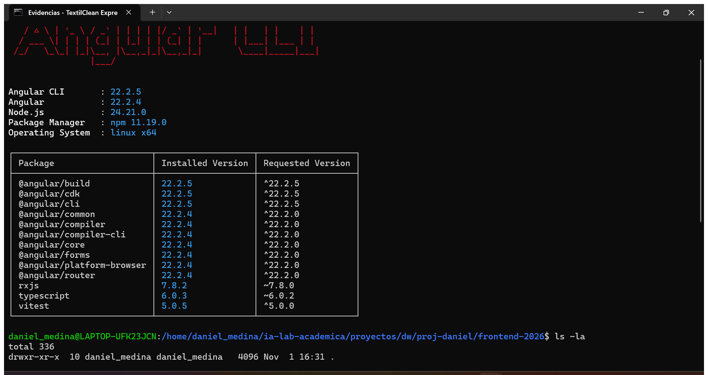

## 1.2 · Instalar PrimeNG compatible con Angular

### Pasos

```bash
ng version
npm view primeng version peerDependencies --json
npm install primeng @primeuix/themes primeicons @angular/cdk
npm ls primeng @primeuix/themes primeicons @angular/cdk --depth=0
```

### Resultado esperado

```
front-textilclean-express@0.0.0
├── @angular/cdk@22.2.5
├── @primeuix/themes@3.1.0
├── primeicons@8.0.2
└── primeng@22.1.4
```

`@angular/cdk` es **peer dependency** de PrimeNG 22: sin él fallan _overlays_ y
_focus trap_. El tema moderno **no** se importa de `primeng/resources/themes`;
el preset Aura vive en `@primeuix/themes`.

### Evidencia

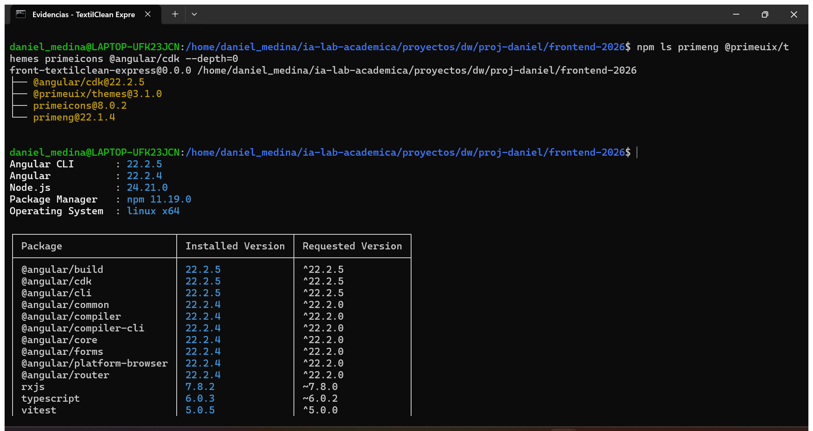

## 1.3 · Estilos globales

### Código — `src/styles.css`

```css
@layer theme, base, primeng, utilities;
@import 'tailwindcss';
@import 'primeicons/primeicons.css';
```

El **orden de capas** hace que las utilidades de Tailwind ganen sobre el tema de
PrimeNG sin `!important`. Es la única hoja global del proyecto: sin selectores
`.p-*`, sin `::ng-deep`, sin clases de aplicación.

### Evidencia

Sin captura: el código completo está en el bloque anterior.

## 1.4 · Configurar PrimeNG en `app.config.ts`

### Código — `src/app/app.config.ts`

```ts
import { ApplicationConfig, provideBrowserGlobalErrorListeners } from '@angular/core';
import { provideRouter, withComponentInputBinding, withInMemoryScrolling } from '@angular/router';
import { ConfirmationService, MessageService } from 'primeng/api';
import { providePrimeNG } from 'primeng/config';
import Aura from '@primeuix/themes/aura';
import { environment } from '../environments/environment';

import { routes } from './app.routes';

export const appConfig: ApplicationConfig = {
  providers: [
    provideBrowserGlobalErrorListeners(),
    provideRouter(
      routes,
      withComponentInputBinding(),
      withInMemoryScrolling({ scrollPositionRestoration: 'top' }),
    ),
    providePrimeNG({
      license: environment.primeUiLicense || undefined,
      ripple: true,
      inputVariant: 'outlined',
      theme: {
        preset: Aura,
        options: {
          darkModeSelector: '.app-dark',
          cssLayer: { name: 'primeng', order: 'theme, base, primeng, utilities' },
        },
      },
    }),
    MessageService,
    ConfirmationService,
  ],
};
```

- `preset: Aura` + `darkModeSelector: '.app-dark'`.
- `cssLayer` con el mismo orden que `styles.css`.
- **No** se añade `provideHttpClient()` (ISS-02).
- **No** se pierde `provideBrowserGlobalErrorListeners()`.

### Licencia de PrimeNG 22

`providePrimeNG` verifica la clave sin conexión. Sin clave:

| Dónde                    | Qué aparece                                  |
| ------------------------ | -------------------------------------------- |
| Consola                  | `[PrimeUI] No license key configured`        |
| Esquina inferior derecha | banda `Invalid PrimeUI License` (Shadow DOM) |

Es un **aviso de licencia**, no un error de código. La clave Community se pega
en `environment.primeUiLicense` (ISS-02).

### Nota: entornos creados antes de tiempo

`app.config.ts` importa `../environments/environment`, así que se crearon:

```ts
// src/environments/environment.ts        (producción)
// src/environments/environment.development.ts (desarrollo)
export const environment = {
  production: false,
  primeUiLicense: '',
};
```

En ISS-02 se completan (URL de API y `fileReplacements`).

### Evidencia

Sin captura: el código completo está en el bloque anterior.

## 1.5 · Pantalla de arranque: `App` compone `demo/ejemplo`

> **Regla mental:** un componente es una etiqueta HTML que se escribe en la
> plantilla de otro componente. La etiqueta es el `selector` de su `@Component`.

### Código — `src/app/app.ts`

```ts
import { Component } from '@angular/core';
import { Ejemplo } from './demo/ejemplo/ejemplo';

@Component({
  host: { class: 'block' },
  selector: 'app-root',
  imports: [Ejemplo],
  templateUrl: './app.html',
  styleUrl: './app.css',
})
export class App {}
```

### Código — `src/app/app.html`

```html
<main class="min-h-dvh bg-slate-50 p-6 text-slate-900">
  <div class="mx-auto w-full max-w-4xl">
    <app-ejemplo />
  </div>
</main>
```

### Código — `src/app/app.routes.ts`

```ts
import { Routes } from '@angular/router';

export const routes: Routes = [];
```

### Código — `src/app/app.css`

```css
/* Vacío a propósito: el aspecto viene de Tailwind y del tema Aura. */
```

### Código — `src/app/demo/ejemplo/ejemplo.ts`

```ts
import { Component, computed, effect, signal } from '@angular/core';
import { ButtonModule } from 'primeng/button';
import { CardModule } from 'primeng/card';
import { InputTextModule } from 'primeng/inputtext';
import { MessageModule } from 'primeng/message';
import { TagModule } from 'primeng/tag';

export interface Producto {
  nombre: string;
  precio: number;
  activo: boolean;
}

@Component({
  host: { class: 'block' },
  selector: 'app-ejemplo',
  imports: [ButtonModule, CardModule, InputTextModule, MessageModule, TagModule],
  templateUrl: './ejemplo.html',
  styleUrl: './ejemplo.css',
})
export class Ejemplo {
  protected readonly producto = signal<Producto>(productoInicial());

  protected readonly precioFinal = computed(() => Math.round(this.producto().precio * 1.19));

  protected readonly estadoTexto = computed(() => (this.producto().activo ? 'Activo' : 'Inactivo'));

  private readonly registro = effect(() => {
    const { nombre, precio, activo } = this.producto();
    console.log(`[ejemplo] ${nombre} · precio ${precio} · ${activo ? 'activo' : 'inactivo'}`);
  });

  protected cambiarNombre(event: Event): void {
    const nombre = (event.target as HTMLInputElement).value;
    this.producto.update((actual) => ({ ...actual, nombre }));
  }

  protected variarPrecio(delta: number): void {
    this.producto.update((actual) => ({
      ...actual,
      precio: Math.max(0, actual.precio + delta),
    }));
  }

  protected alternarEstado(): void {
    this.producto.update((actual) => ({ ...actual, activo: !actual.activo }));
  }

  protected reiniciar(): void {
    this.producto.set(productoInicial());
  }
}

function productoInicial(): Producto {
  return { nombre: 'Café molido 500 g', precio: 18000, activo: true };
}
```

### Código — `src/app/demo/ejemplo/ejemplo.html`

```html
<div class="flex flex-col gap-6">
  <p-card header="Objeto producto">
    <div class="flex flex-col gap-4">
      <label class="flex flex-col gap-1 text-sm text-slate-600">
        Nombre
        <input pInputText [value]="producto().nombre" (input)="cambiarNombre($event)" />
      </label>

      <p class="text-sm text-slate-500">Vista previa: <strong>{{ producto().nombre }}</strong></p>

      <p class="text-2xl font-bold text-slate-900">{{ producto().precio }}</p>
      <p class="text-sm text-slate-500">
        Precio final con IVA (19 %): <strong>{{ precioFinal() }}</strong>
      </p>

      <div class="flex flex-wrap items-center gap-2">
        <button pButton type="button" (click)="variarPrecio(1000)">
          <span pButtonLabel>+1000</span>
        </button>
        <button pButton type="button" severity="secondary" (click)="variarPrecio(-1000)">
          <span pButtonLabel>-1000</span>
        </button>
        <button pButton type="button" outlined (click)="alternarEstado()">
          <span pButtonLabel>Cambiar estado</span>
        </button>
        <button pButton type="button" text (click)="reiniciar()">
          <span pButtonLabel>Reiniciar</span>
        </button>
      </div>

      <p-tag [value]="estadoTexto()" [severity]="producto().activo ? 'success' : 'danger'" />

      @if (producto().activo) {
      <p-message severity="success" variant="simple">
        Producto activo: la API lo devolvería en <code>GET /api/productos</code>.
      </p-message>
      } @else {
      <p-message severity="warn" variant="simple">
        Producto inactivo: el borrado lógico lo oculta de las listas.
      </p-message>
      }
    </div>
  </p-card>

  <p-card header="Estilos">
    <div class="ejemplo-alcance mt-4 text-sm text-slate-700">
      Esta caja lleva la clase <code>.ejemplo-alcance</code> definida en <code>ejemplo.css</code>.
      El resto del contenido usa Tailwind.
    </div>
  </p-card>
</div>
```

### Código — `src/app/demo/ejemplo/ejemplo.css`

```css
/* src/app/demo/ejemplo/ejemplo.css — únicamente demostrativo. */
.ejemplo-alcance {
  border: 2px dashed #0f766e;
  border-radius: 0.75rem;
  padding: 0.75rem 1rem;
  background-color: #f0fdfa;
}
```

### Pruebas

`src/app/app.spec.ts` (3 pruebas) y `src/app/demo/ejemplo/ejemplo.spec.ts`
(4 pruebas): creación, render de `<app-ejemplo>`, producto inicial, `+1000` →
`19000` y reinicio a `18000`.

### Evidencia

Sin captura: el código completo está en el bloque anterior.

## 1.6 · Personalizar `index.html`

### Código — `src/index.html`

```html
<!doctype html>
<html lang="es">
  <head>
    <meta charset="utf-8" />
    <title>TextilClean Express · Angular 22</title>
    <base href="/" />
    <meta name="viewport" content="width=device-width, initial-scale=1" />
    <meta
      name="description"
      content="Frontend Angular 22 con Signals, PrimeNG y Tailwind para TextilClean Express."
    />
    <link rel="icon" type="image/x-icon" href="favicon.ico" />
  </head>
  <body class="m-0 bg-slate-100 font-sans text-slate-900">
    <app-root></app-root>
  </body>
</html>
```

Las clases del `<body>` son **utilidades Tailwind**: fondo, fuente y color.

### Evidencia

Sin captura: el código completo está en el bloque anterior.

## 1.7 · Presupuesto de build

### Código — `angular.json`

```json
{
  "type": "initial",
  "maximumWarning": "750kB",
  "maximumError": "1MB"
}
```

Ubicación: `projects → front-textilclean-express → architect → build →
configurations → production → budgets`.

### Evidencia

Sin captura: el fragmento completo está en el bloque anterior.

## 1.8 · Primera ejecución

### Build de producción

```bash
npm run build
```

Resultado obtenido:

```
Initial chunk files | Names         |  Raw size
main-H4NYKSPG.js    | main          | 585.92 kB
styles-5W5JPEJJ.css | styles        |  20.48 kB
                    | Initial total | 606.40 kB
Application bundle generation complete. [17.233 seconds]
EXIT=0
```

### Pruebas

```bash
ng test --watch=false
```

```
Test Files  2 passed (2)
     Tests  7 passed (7)
```

### Servidor de desarrollo

```bash
npm start
```

```
➜  Local:   http://localhost:4200/
```

| Comprobación visual | Resultado esperado                                     |
| ------------------- | ------------------------------------------------------ |
| Estado inicial      | «Café molido 500 g», 18000, IVA 21420, etiqueta Activo |
| `+1000`             | 19000, IVA 22610, consola `[ejemplo] … precio 19000 …` |
| `-1000`             | 18000                                                  |
| Cambiar estado      | Etiqueta Inactivo + aviso de borrado lógico            |
| Campo Nombre        | «Vista previa: …» cambia con cada tecla                |
| Reiniciar           | «Café molido 500 g», 18000, Activo                     |
| Caja de estilos     | borde discontinuo verde (`.ejemplo-alcance`)           |
| Network             | `styles.css`, `main.js` y chunks con `200`             |

### Evidencias

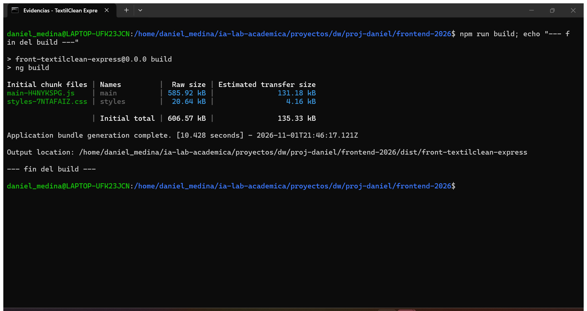

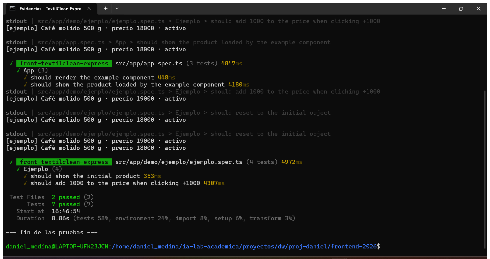

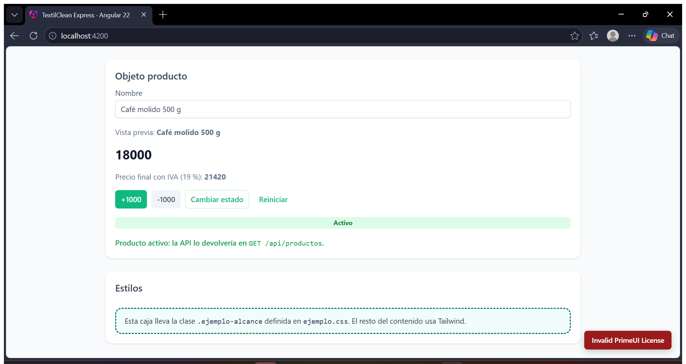

## 1.9 · Anatomía del componente y signals

### De `index.html` a la pantalla

```
index.html
   └─ <app-root></app-root>
         │
         ├─ src/main.ts              bootstrapApplication(App, appConfig)
         ├─ src/app/app.config.ts    providers globales
         └─ src/app/app.ts            clase App + @Component
               ├─ app.html            <main> + <app-ejemplo />
               ├─ app.css             vacío
               ├─ app.spec.ts         pruebas de App
               └─ app.routes.ts       vacío en ISS-01
                     │
                     ▼
               src/app/demo/ejemplo/
                     ├─ ejemplo.ts        clase Ejemplo + @Component
                     ├─ ejemplo.html      las dos tarjetas
                     ├─ ejemplo.css       una clase de demostración
                     └─ ejemplo.spec.ts   4 pruebas
```

### Los cuatro archivos de un componente

| Archivo           | Qué hace                                                        | ¿Obligatorio?        |
| ----------------- | --------------------------------------------------------------- | -------------------- |
| `ejemplo.ts`      | clase + `@Component` (selector, imports, templateUrl, styleUrl) | sí                   |
| `ejemplo.html`    | estructura de la vista                                          | no (puede ir inline) |
| `ejemplo.css`     | estilos encapsulados                                            | no                   |
| `ejemplo.spec.ts` | pruebas unitarias                                               | no                   |

### `signal`, `computed` y `effect`

| Concepto   | En el código                       | Función                                                          |
| ---------- | ---------------------------------- | ---------------------------------------------------------------- |
| `signal`   | `producto = signal<Producto>(...)` | estado reactivo; se lee `producto()` y se escribe `set`/`update` |
| `computed` | `precioFinal`, `estadoTexto`       | valor derivado; se recalcula solo cuando cambia el signal        |
| `effect`   | `registro`                         | efecto secundario (log) que se ejecuta al cambiar el signal      |

**Actualizar un objeto sin mutarlo:** `update((actual) => ({ ...actual, precio }))`
crea un objeto nuevo; así el signal detecta el cambio por identidad.

**Sin Zone.js:** el cambio se detecta porque el template lee el signal; Angular
marca el componente para revisión y actualiza solo lo necesario.

### El selector se convierte en etiqueta

`selector: 'app-ejemplo'` en `ejemplo.ts` permite escribir `<app-ejemplo />` en
`app.html`. Para que Angular lo reconozca, `App` debe importar `Ejemplo` en
`imports: [Ejemplo]`.

### Aislamiento de estilos

`.ejemplo-alcance` se define en `ejemplo.css`. Angular añade un atributo
`_ngcontent-…` al elemento y al selector compilado, de modo que la clase solo
aplica dentro de ese componente.

---

# ISS-02 · Modelos, servicios y layout

**Fase:** 1 · Núcleo del frontend · **Bloqueado por:** ISS-01 · **Habilita:** ISS-03

Dejar lista la capa de datos (modelos + servicios HTTP), las utilidades
compartidas, los componentes de UI reutilizables y el **layout único** (Shell)
sobre el que ISS-03 montará el módulo de Clientes.

> **Nota de alcance.** El plan original daba por hecha ISS-01B (Header, Aside,
> Footer y `construir`). En este proyecto ISS-01B no se ejecutó, así que ISS-02
> crea **todo** el layout. `construir` queda como pantalla de prototipo dentro
> del Shell y `/` redirige a ella hasta que ISS-03 agregue `/clientes`.

**Resultado del bloque:** `npm run build` → `EXIT=0` (736.13 kB iniciales,
`construir` en chunk aparte), `npm test` → **7 archivos, 20 pruebas, 0 fallos**,
`http://localhost:4200` → `200` con el Shell renderizado.

> Los bloques **2.12 a 2.14** son una segunda pasada: una auditoría contra los
> DTOs y rutas reales del backend encontró desajustes de contrato (ver
> [2.12](#212--corrección-de-modelos-los-dtos-del-backend)). Se corrigieron y se
> volvió a compilar, probar y documentar. El estado final es el de 2.14.

---

## 2.1 · Entornos y `fileReplacements`

### Qué se hace

1. Completar `src/environments/environment.ts` (producción) y
   `environment.development.ts` (desarrollo) con las cuatro claves del proyecto.
2. Registrar el reemplazo en `angular.json` para que `ng serve` y `ng test` usen
   el archivo de desarrollo y `ng build` use el de producción.

### Código

```ts
// src/environments/environment.ts
/**
 * Entorno de producción (`ng build`).
 *
 * `apiUrl` termina en `/api` SIN slash final: con uno, las llamadas saldrían
 * como `//clientes` y Express las trataría como otra ruta.
 *
 * `requireAuth`: mitad frontal del interruptor de fases. Nadie lo lee hasta
 * ISS-08 (Fase II). Se empareja con `AUTH_ENABLED` del backend.
 *
 * `primeUiLicense`: clave Community de PrimeUI (PrimeNG 22). Vacía = aviso en
 * consola; la app funciona.
 */
export const environment = {
  production: true,
  appName: 'TextilClean Express',
  apiUrl: 'http://localhost:3000/api',
  requireAuth: true,
  primeUiLicense: '',
};
```

```ts
// src/environments/environment.development.ts
export const environment = {
  production: false,
  appName: 'TextilClean Express',
  apiUrl: 'http://localhost:3000/api',
  requireAuth: true,
  primeUiLicense: '',
};
```

```jsonc
// angular.json → projects.front-textilclean-express.architect.build.configurations.development
"development": {
  "optimization": false,
  "extractLicenses": false,
  "sourceMap": true,
  "fileReplacements": [
    {
      "replace": "src/environments/environment.ts",
      "with": "src/environments/environment.development.ts"
    }
  ]
}
```

Se aplicó con un script de Python para no editar el JSON a mano (así se evita
romper comas o el orden de las claves):

```bash
python3 - <<'PY'
import json

ruta = 'angular.json'
j = json.load(open(ruta))
p = list(j['projects'])[0]
dev = j['projects'][p]['architect']['build']['configurations']['development']
dev['fileReplacements'] = [
    {
        'replace': 'src/environments/environment.ts',
        'with': 'src/environments/environment.development.ts',
    }
]
with open(ruta, 'w') as f:
    json.dump(j, f, indent=2)
    f.write('\n')
print('development.fileReplacements =', json.dumps(dev['fileReplacements']))
PY
```

### Resultado esperado

```
development.fileReplacements = [{"replace": "src/environments/environment.ts",
"with": "src/environments/environment.development.ts"}]
```

### Evidencia

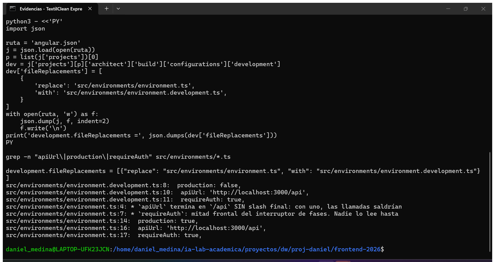

---

## 2.2 · Modelos (`src/app/core/models/`)

### Qué se hace

Crear 13 archivos de tipos que reflejan **campo a campo** las tablas del backend
(`clients`, `product_types`, `products`, `sales`, `product_sales`, `users`,
`roles`, `resources`, `role_users`, `resource_roles`) y los contratos de sesión y
dashboard.

### Reglas que siguen los modelos

| Regla                                | Motivo                                                             |
| ------------------------------------ | ------------------------------------------------------------------ |
| `Status = 'active' \| 'inactive'`    | el backend nunca devuelve otro valor                               |
| `Money = number \| string`           | MySQL `DECIMAL` llega como string en algunos drivers               |
| `toNumber(valor)`                    | normaliza `Money` antes de sumar o formatear                       |
| `Timestamps`                         | `createdAt` / `updatedAt` son opcionales según la consulta         |
| `XxxPayload` separado de `Xxx`       | el DTO de escritura no incluye `id` ni `status` en todos los casos |
| `status` fuera de los DTO de `PATCH` | el estado solo cambia con `PATCH /:id/deactivate`                  |

### Código base compartido

```ts
// src/app/core/models/api.model.ts
export type Status = 'active' | 'inactive';
export type Money = number | string;

export interface ApiError {
  error: string;
  detail?: string;
}

/** Firma mínima de los objetos Sequelize que devuelve el backend. */
export interface Timestamps {
  createdAt?: string;
  updatedAt?: string;
}

/** DECIMAL puede llegar como number o como string: se normaliza aquí. */
export function toNumber(value: Money | null | undefined): number {
  const parsed = Number(value ?? 0);
  return Number.isFinite(parsed) ? parsed : 0;
}
```

### Los 13 archivos

| Archivo                  | Interfaces                                                        | Campos propios                                                                 |
| ------------------------ | ----------------------------------------------------------------- | ------------------------------------------------------------------------------ |
| `api.model.ts`           | `Status`, `Money`, `ApiError`, `Timestamps`                       | tipos base + `toNumber()`                                                      |
| `client.model.ts`        | `Client`, `ClientPayload`                                         | `name`, `address`, `phone`, `email`, `status`                                  |
| `product-type.model.ts`  | `ProductType`, `ProductTypePayload`                               | `name`, `description`, `status`                                                |
| `product.model.ts`       | `Product`, `ProductPayload`                                       | `name`, `brand`, `price`, `min_stock`, `quantity`, `product_type_id`, `status` |
| `sale.model.ts`          | `Sale`, `SaleItemInput`, `SaleCreatePayload`, `SaleUpdatePayload` | `sale_date`, `subtotal`, `tax`, `discounts`, `total`, `client_id`, `items`     |
| `product-sale.model.ts`  | `ProductSale`, `ProductSalePayload`                               | `sale_id`, `product_id`, `quantity`, `unit_price`, `line_total`, `status`      |
| `user.model.ts`          | `User`, `UserPayload`                                             | `username`, `email`, `avatar`, `status` (nunca `password`)                     |
| `role.model.ts`          | `Role`, `RolePayload`                                             | `name`, `description`, `status`                                                |
| `resource.model.ts`      | `HttpMethod`, `HTTP_METHODS`, `Resource`, `ResourcePayload`       | `path`, `method`, `description`, `status`                                      |
| `role-user.model.ts`     | `RoleUser`                                                        | `user_id`, `role_id`, `status` + `user` / `role` anidados                      |
| `resource-role.model.ts` | `ResourceRole`                                                    | `resource_id`, `role_id`, `status` + `role` / `resource` anidados              |
| `auth.model.ts`          | `SessionTokens`, `EffectivePermission`                            | tokens de sesión y permisos efectivos                                          |
| `dashboard.model.ts`     | `DashboardStats`, `DashboardData`                                 | contadores, `lowStockProducts`, `latestSales`                                  |

### Ejemplo completo (el modelo con más piezas)

```ts
// src/app/core/models/sale.model.ts
import { Money, Status, Timestamps } from './api.model';
import { ProductSale } from './product-sale.model';

/** Tabla `sales` — /api/ventas */
export interface Sale extends Timestamps {
  id: number;
  sale_date: string;
  subtotal: Money;
  tax: Money;
  discounts: Money;
  total: Money;
  client_id: number;
  status: Status;
  /** El backend incluye el detalle con `include: [{ model: ProductSale, as: 'items' }]`. */
  items?: ProductSale[];
}

export interface SaleItemInput {
  product_id: number;
  quantity: number;
}

export interface SaleCreatePayload {
  client_id: number;
  tax?: number;
  discounts?: number;
  sale_date?: string;
  items: SaleItemInput[];
}

export interface SaleUpdatePayload {
  client_id?: number;
  tax?: number;
  discounts?: number;
  sale_date?: string;
}
```

### Resultado esperado

```
13 archivos .model.ts en src/app/core/models/
npx tsc -p tsconfig.app.json --noEmit → sin salida (0 errores)
```

### Evidencia

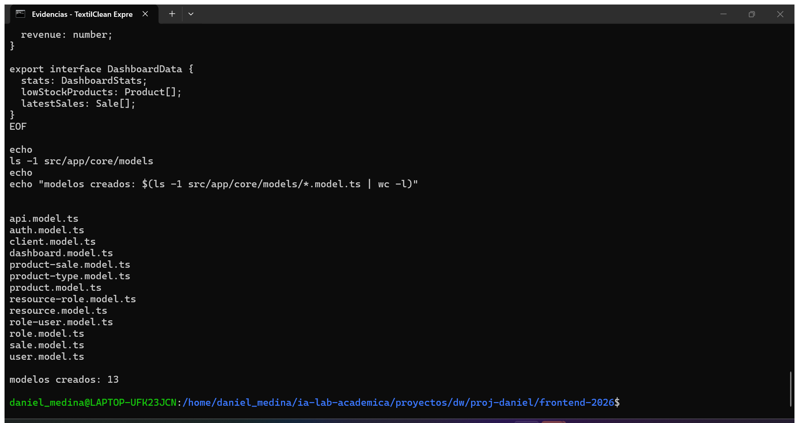

---

## 2.3 · Servicios de API

### Qué se hace

Un servicio `@Injectable({ providedIn: 'root' })` por recurso. Todos:

- leen la URL base de `environment.apiUrl` (sin slash final);
- **desenvuelven** la envoltura del backend (`{ clients }`, `{ products }`, …);
- exponen `list`, `get` y, cuando el recurso lo permite, `create`, `update`,
  `deactivate`, `reactivate` o `remove`. Los dos pivotes de relación
  (`role-users`, `resource-roles`) sólo exponen asignación/baja, no `create`
  genérico.

### Archivos y contrato

| Servicio                                             | URL base            | Envoltura                        | Métodos                                                               |
| ---------------------------------------------------- | ------------------- | -------------------------------- | --------------------------------------------------------------------- |
| `features/clients/client-api.ts`                     | `/clientes`         | `clients` / `client`             | list, get, create, update, replace, deactivate, remove                |
| `features/product-types/product-type-api.ts`         | `/tipos-producto`   | `product_types` / `product_type` | list, get, create, update, deactivate, remove                         |
| `features/products/product-api.ts`                   | `/productos`        | `products` / `product`           | list, get, create, update, deactivate, remove                         |
| `features/sales/sale-api.ts`                         | `/ventas`           | `sales` / `sale`                 | list, get, create (`{ sale }`), update, deactivate, remove            |
| `features/product-sales/product-sale-api.ts`         | `/detalle-ventas`   | `product_sales` / `product_sale` | list, get, create, update (`quantity`), deactivate, remove            |
| `features/admin/users/user-api.ts`                   | `/usuarios`         | `users` / `user`                 | list, get, create, update, `permisos`, `password`, deactivate, remove |
| `features/admin/roles/role-api.ts`                   | `/roles`            | `roles` / `role`                 | list, get, create, update, deactivate, remove                         |
| `features/admin/resources/resource-api.ts`           | `/recursos`         | `resources` / `resource`         | list, get, create, update, deactivate, remove                         |
| `features/admin/role-users/role-user-api.ts`         | `/asignaciones-rol` | `assignments` / `assignment`     | list, get, `assign`, deactivate, reactivate                           |
| `features/admin/resource-roles/resource-role-api.ts` | `/concesiones-rol`  | `grants` / `grant`               | list (filtros), get, `grant`, deactivate, reactivate                  |

> `assignments` y `grants` son los nombres reales que devuelve Express; no son
> `role_users` ni `resource_roles`. Ese detalle se verificó leyendo los
> controladores antes de escribir los servicios.

### Servicio completo (plantilla de los demás)

```ts
// src/app/features/clients/client-api.ts
import { HttpClient } from '@angular/common/http';
import { Injectable, inject } from '@angular/core';
import { Observable, map } from 'rxjs';
import { environment } from '../../../environments/environment';
import { Client, ClientPayload } from '../../core/models/client.model';

/** Contrato exacto de `features/business/clients` en Express. */
@Injectable({ providedIn: 'root' })
export class ClientApi {
  private readonly http = inject(HttpClient);
  private readonly base = `${environment.apiUrl}/clientes`;

  list(): Observable<Client[]> {
    return this.http
      .get<{ clients: Client[] }>(this.base)
      .pipe(map((response) => response.clients));
  }

  get(id: number): Observable<Client> {
    return this.http
      .get<{ client: Client }>(`${this.base}/${id}`)
      .pipe(map((response) => response.client));
  }

  create(payload: ClientPayload): Observable<Client> {
    return this.http
      .post<{ client: Client }>(this.base, payload)
      .pipe(map((response) => response.client));
  }

  /** PATCH /api/clientes/:id — actualización parcial (la que usa el formulario). */
  update(id: number, payload: Partial<ClientPayload>): Observable<Client> {
    return this.http
      .patch<{ client: Client }>(`${this.base}/${id}`, payload)
      .pipe(map((response) => response.client));
  }

  /** PUT /api/clientes/:id — reemplazo completo. */
  replace(id: number, payload: ClientPayload): Observable<Client> {
    return this.http
      .put<{ client: Client }>(`${this.base}/${id}`, payload)
      .pipe(map((response) => response.client));
  }

  /** Baja lógica: status = inactive. */
  deactivate(id: number): Observable<unknown> {
    return this.http.patch(`${this.base}/${id}/deactivate`, {});
  }

  /** Baja física: DELETE. */
  remove(id: number): Observable<unknown> {
    return this.http.delete(`${this.base}/${id}`);
  }
}
```

### Prueba del contrato

```ts
// src/app/features/clients/client-api.spec.ts (extracto)
it('should unwrap { clients } into Client[]', () => {
  let resultado: Client[] | undefined;
  api.list().subscribe((clients) => (resultado = clients));

  const peticion = http.expectOne(BASE);
  expect(peticion.request.method).toBe('GET');
  peticion.flush({ clients: [CLIENTE] });

  expect(resultado).toEqual([CLIENTE]);
});
```

La prueba usa `provideHttpClient()` + `provideHttpClientTesting()` y
`http.verify()` en `afterEach`, así que una URL mal escrita falla el test.

### Resultado esperado

```
10 servicios *-api.ts
find src/app/features -name '*-api.ts' | wc -l → 10
```

### Evidencia

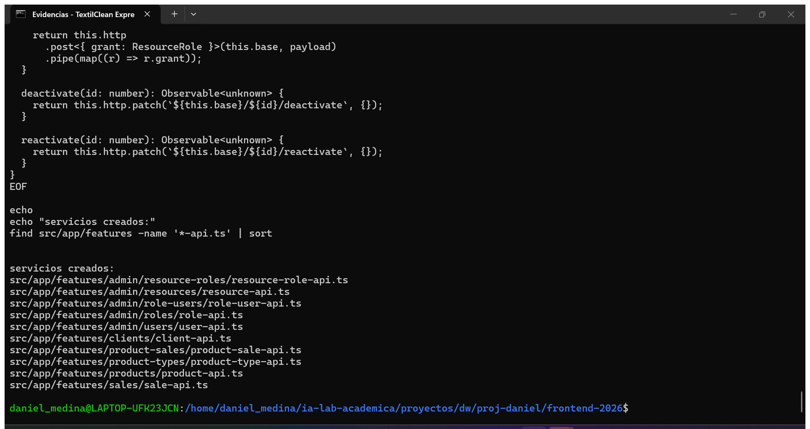

---

## 2.4 · Utilidades y notificaciones

### Qué se hace

Tres piezas transversales (dos con prueba propia, `notification` se cubre de
forma indirecta al usarse desde los componentes):

| Archivo                         | Para qué                                                              |
| ------------------------------- | --------------------------------------------------------------------- |
| `core/utils/api-error.ts`       | convertir cualquier error HTTP en un mensaje legible                  |
| `core/services/notification.ts` | atajos `success/info/warn/error` sobre `MessageService` de PrimeNG    |
| `core/utils/media-query.ts`     | signal que sigue una media query (lo usa el Shell para el breakpoint) |

### Código

```ts
// src/app/core/utils/api-error.ts
import { HttpErrorResponse } from '@angular/common/http';

/**
 * Traduce el error HTTP del backend a un texto para el usuario.
 * Express responde `{ error, detail? }`; los 403 de RBAC son opacos a propósito.
 */
export function toApiMessage(error: unknown): string {
  if (error instanceof HttpErrorResponse) {
    const body = error.error as { error?: string; detail?: string } | string | null;

    if (error.status === 0) {
      return 'No se pudo conectar con el backend. Verifica que esté en http://localhost:3000.';
    }
    if (typeof body === 'string' && body.trim()) {
      return body;
    }
    if (body && typeof body === 'object' && body.error) {
      return body.detail ? `${body.error} — ${body.detail}` : body.error;
    }
    return error.message;
  }
  return error instanceof Error ? error.message : 'Error inesperado';
}
```

```ts
// src/app/core/services/notification.ts
import { Injectable, inject } from '@angular/core';
import { MessageService } from 'primeng/api';

/** Azúcar sintáctica sobre MessageService para no repetir `severity/life`. */
@Injectable({ providedIn: 'root' })
export class NotificationService {
  private readonly messages = inject(MessageService);

  success(summary: string, detail?: string): void {
    this.messages.add({ severity: 'success', summary, detail, life: 3000 });
  }

  info(summary: string, detail?: string): void {
    this.messages.add({ severity: 'info', summary, detail, life: 3500 });
  }

  warn(summary: string, detail?: string): void {
    this.messages.add({ severity: 'warn', summary, detail, life: 4500 });
  }

  error(summary: string, detail?: string): void {
    this.messages.add({ severity: 'error', summary, detail, life: 6000 });
  }
}
```

```ts
// src/app/core/utils/media-query.ts
import { DestroyRef, Signal, inject, signal } from '@angular/core';

/**
 * Devuelve un signal que sigue el resultado de una media query.
 *
 * Debe llamarse en un contexto de inyección (campo de un componente o
 * servicio). En jsdom (pruebas) no existe `window.matchMedia`: el signal queda
 * en `false` y las pruebas ejercitan la rama móvil.
 */
export function watchMediaQuery(query: string): Signal<boolean> {
  const media =
    typeof window !== 'undefined' && typeof window.matchMedia === 'function'
      ? window.matchMedia(query)
      : null;

  const matches = signal(media?.matches ?? false);

  if (media) {
    const listener = (event: MediaQueryListEvent): void => matches.set(event.matches);
    media.addEventListener('change', listener);
    inject(DestroyRef).onDestroy(() => media.removeEventListener('change', listener));
  }

  return matches.asReadonly();
}
```

### Resultado esperado

```
src/app/core/utils/api-error.ts        + api-error.spec.ts      (5 casos)
src/app/core/services/notification.ts                            (sin prueba propia)
src/app/core/utils/media-query.ts      + media-query.spec.ts    (2 casos)
```

### Evidencia

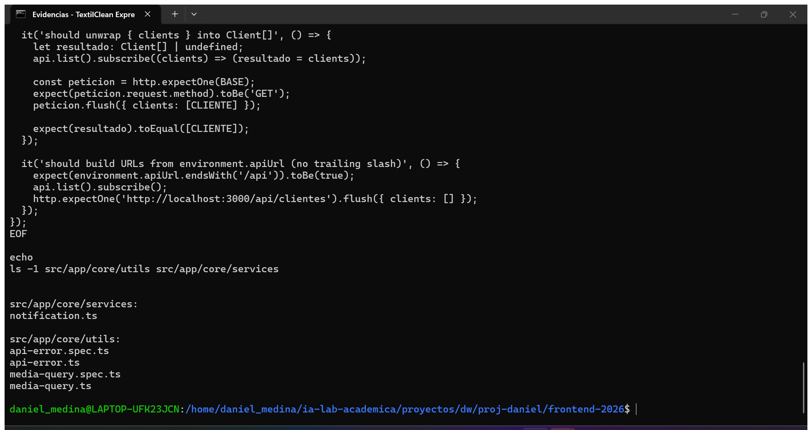

---

## 2.5 · Componentes compartidos (`src/app/shared/ui/`)

### Qué se hace

Tres componentes de presentación, sin lógica de negocio, reutilizables por todas
las pantallas de ISS-03 en adelante:

| Componente   | Selector            | Entradas                                        |
| ------------ | ------------------- | ----------------------------------------------- |
| `PageHeader` | `<app-page-header>` | `title` (obligatoria), `subtitle`, `ng-content` |
| `EmptyState` | `<app-empty-state>` | `icon`, `title`, `message`, `ng-content`        |
| `StatusTag`  | `<app-status-tag>`  | `status: Status` → `p-tag` verde/rojo           |

### Código

```ts
// src/app/shared/ui/page-header/page-header.ts
import { Component, input } from '@angular/core';

@Component({
  host: { class: 'block' },
  selector: 'app-page-header',
  templateUrl: './page-header.html',
  styleUrl: './page-header.css',
})
export class PageHeader {
  readonly title = input.required<string>();
  readonly subtitle = input<string>('');
}
```

```html
<!-- src/app/shared/ui/page-header/page-header.html -->
<header class="mb-6 flex flex-col gap-4 md:flex-row md:items-end md:justify-between">
  <div>
    <h1 class="text-2xl font-semibold tracking-tight text-slate-900">{{ title() }}</h1>
    @if (subtitle()) {
    <p class="mt-1 max-w-2xl text-sm text-slate-500">{{ subtitle() }}</p>
    }
  </div>
  <div class="flex flex-wrap items-center gap-2">
    <ng-content />
  </div>
</header>
```

```ts
// src/app/shared/ui/empty-state/empty-state.ts
import { Component, input } from '@angular/core';

@Component({
  host: { class: 'block' },
  selector: 'app-empty-state',
  templateUrl: './empty-state.html',
  styleUrl: './empty-state.css',
})
export class EmptyState {
  readonly icon = input<string>('pi pi-inbox');
  readonly title = input<string>('Sin registros');
  readonly message = input<string>('Todavía no hay datos para mostrar.');
}
```

```html
<!-- src/app/shared/ui/empty-state/empty-state.html -->
<div class="flex flex-col items-center justify-center gap-2 px-6 py-12 text-center">
  <div class="flex h-12 w-12 items-center justify-center rounded-full bg-slate-100 text-slate-500">
    <i [class]="'text-xl ' + icon()"></i>
  </div>
  <p class="mt-2 text-sm font-semibold text-slate-700">{{ title() }}</p>
  <p class="max-w-sm text-sm text-slate-500">{{ message() }}</p>
  <div class="mt-3"><ng-content /></div>
</div>
```

```ts
// src/app/shared/ui/status-tag/status-tag.ts
import { Component, computed, input } from '@angular/core';
import { TagModule } from 'primeng/tag';
import { Status } from '../../../core/models/api.model';

@Component({
  host: { class: 'inline-block' },
  selector: 'app-status-tag',
  imports: [TagModule],
  templateUrl: './status-tag.html',
  styleUrl: './status-tag.css',
})
export class StatusTag {
  readonly status = input.required<Status>();

  readonly label = computed(() => (this.status() === 'active' ? 'Activo' : 'Inactivo'));
  readonly severity = computed<'success' | 'danger'>(() =>
    this.status() === 'active' ? 'success' : 'danger',
  );
}
```

```html
<!-- src/app/shared/ui/status-tag/status-tag.html -->
<p-tag [value]="label()" [severity]="severity()" [rounded]="true" />
```

### Prueba

```ts
// src/app/shared/ui/status-tag/status-tag.spec.ts
it('should react when the input changes to inactive', async () => {
  const fixture = TestBed.createComponent(StatusTag);
  fixture.componentRef.setInput('status', 'active');
  await fixture.whenStable();

  fixture.componentRef.setInput('status', 'inactive');
  await fixture.whenStable();

  expect(fixture.componentInstance.label()).toBe('Inactivo');
  expect(fixture.componentInstance.severity()).toBe('danger');
});
```

### Corrección aplicada en este bloque

`npx tsc --noEmit` falló con:

```
src/app/core/models/resource-role.model.ts(1,10):
error TS2305: Module '"./api.model"' has no exported member 'HttpMethod'.
```

`HttpMethod` vive en `resource.model.ts`, no en `api.model.ts`. Se corrigió el
import y se volvió a compilar:

```bash
sed -i "s|import { HttpMethod, Status, Timestamps } from './api.model';|import { Status, Timestamps } from './api.model';\nimport { HttpMethod } from './resource.model';|" \
  src/app/core/models/resource-role.model.ts
npx tsc -p tsconfig.app.json --noEmit
echo "TSC_EXIT=$?"
```

```
TSC_EXIT=0
```

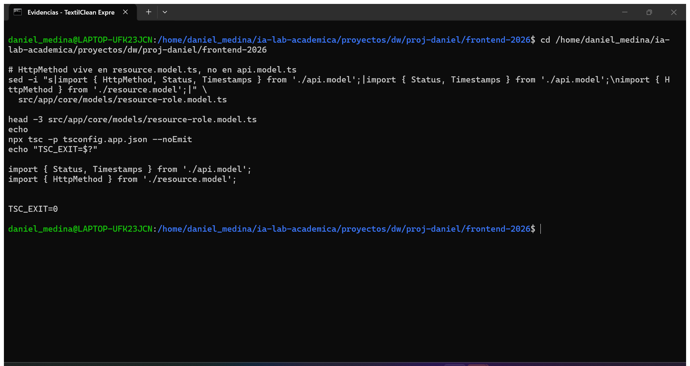

### Evidencia

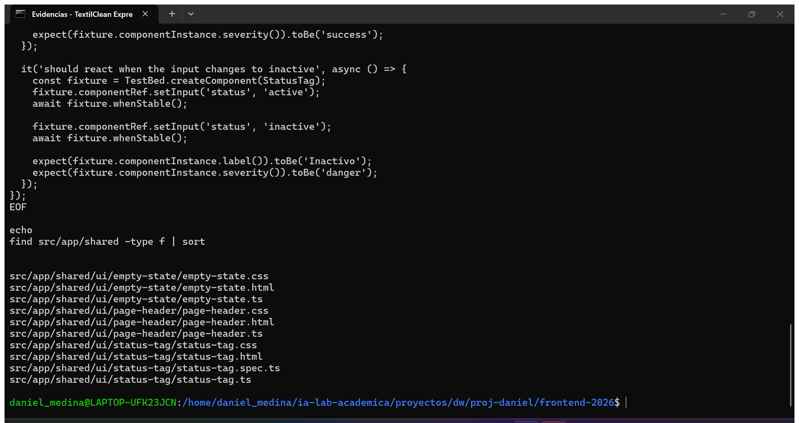

---

## 2.6 · Layout único (Header, Aside, Footer y Shell)

### Qué se hace

| Pieza                | Responsabilidad                                                      |
| -------------------- | -------------------------------------------------------------------- |
| `layout/header`      | barra superior; emite `menuRequested`, no conoce el estado del menú  |
| `layout/aside`       | menú de módulos; reutilizado por el Aside fijo y por el Drawer móvil |
| `layout/footer`      | pie de página con año dinámico                                       |
| `layout/shell`       | compone Header + Aside + `<router-outlet />` + Footer **una vez**    |
| `features/construir` | pantalla de prototipo (reutiliza `<app-ejemplo />` de ISS-01)        |

### Regla del botón del menú

```
click en Header
   ├─ ancho >= 1024 px → sidebarCollapsed = !sidebarCollapsed   (colapsa el Aside)
   └─ ancho <  1024 px → mobileOpen = true                      (abre el p-drawer)
```

El punto de corte se evalúa con `watchMediaQuery('(min-width: 1024px)')` y no con
CSS, para que el mismo botón haga una cosa u otra según el ancho.

### Código

```ts
// src/app/layout/header/header.ts
import { Component, output } from '@angular/core';
import { RouterLink } from '@angular/router';
import { ButtonModule } from 'primeng/button';

/**
 * Barra superior del layout. No conoce el estado del menú: solo avisa con
 * `menuRequested` y el Shell decide si colapsa el Aside o abre el Drawer.
 */
@Component({
  host: { class: 'block' },
  selector: 'app-header',
  imports: [RouterLink, ButtonModule],
  templateUrl: './header.html',
  styleUrl: './header.css',
})
export class Header {
  readonly menuRequested = output<void>();
}
```

```html
<!-- src/app/layout/header/header.html -->
<header class="sticky top-0 z-20 border-b border-slate-200 bg-white/90 backdrop-blur">
  <div class="flex h-16 items-center gap-3 px-4 sm:px-6">
    <button
      pButton
      type="button"
      severity="secondary"
      [text]="true"
      [rounded]="true"
      aria-label="Mostrar u ocultar el menú"
      (click)="menuRequested.emit()"
    >
      <span pButtonIcon class="pi pi-bars"></span>
    </button>

    <a routerLink="/" class="flex items-center gap-2 text-slate-900">
      <i class="pi pi-box text-xl text-teal-600"></i>
      <span class="text-lg font-semibold tracking-tight">TextilClean Express</span>
    </a>
  </div>
</header>
```

```ts
// src/app/layout/aside/aside.ts
import { Component, input, output } from '@angular/core';
import { RouterLink, RouterLinkActive } from '@angular/router';
import { MenuItem } from 'primeng/api';

/** Menú lateral reutilizable: lo usan el Aside de escritorio y el Drawer móvil. */
@Component({
  host: { class: 'block h-full' },
  selector: 'app-aside',
  imports: [RouterLink, RouterLinkActive],
  templateUrl: './aside.html',
  styleUrl: './aside.css',
})
export class Aside {
  readonly items = input<MenuItem[]>([]);
  readonly navigated = output<void>();
}
```

```html
<!-- src/app/layout/aside/aside.html -->
<nav
  aria-label="Navegación principal"
  class="flex h-full flex-col gap-1 border-r border-slate-200 bg-white p-3"
>
  <p class="px-3 pb-2 text-xs font-semibold uppercase tracking-wide text-slate-400">Módulos</p>

  @for (item of items(); track item.label) {
  <a
    [routerLink]="item.routerLink"
    routerLinkActive="bg-teal-50 text-teal-700"
    class="flex items-center gap-2 rounded-md px-3 py-2 text-sm font-medium text-slate-700 transition hover:bg-slate-100"
    (click)="navigated.emit()"
  >
    <i [class]="item.icon ?? 'pi pi-angle-right'"></i>
    <span>{{ item.label }}</span>
  </a>
  }
</nav>
```

```ts
// src/app/layout/footer/footer.ts
import { Component } from '@angular/core';

@Component({
  host: { class: 'block' },
  selector: 'app-footer',
  templateUrl: './footer.html',
  styleUrl: './footer.css',
})
export class Footer {
  protected readonly year = new Date().getFullYear();
}
```

```html
<!-- src/app/layout/footer/footer.html -->
<footer class="border-t border-slate-200 bg-white px-4 py-4 text-xs text-slate-500 sm:px-6">
  <div class="flex flex-col gap-1 sm:flex-row sm:items-center sm:justify-between">
    <p>© {{ year }} TextilClean Express · Sistema de gestión textil</p>
    <p>Angular 22 · PrimeNG 22 · Tailwind CSS 4</p>
  </div>
</footer>
```

```ts
// src/app/layout/shell/shell.ts
import { Component, signal } from '@angular/core';
import { RouterOutlet } from '@angular/router';
import { MenuItem } from 'primeng/api';
import { ConfirmDialogModule } from 'primeng/confirmdialog';
import { DrawerModule } from 'primeng/drawer';
import { ToastModule } from 'primeng/toast';
import { watchMediaQuery } from '../../core/utils/media-query';
import { Aside } from '../aside/aside';
import { Footer } from '../footer/footer';
import { Header } from '../header/header';

/**
 * Layout único de la aplicación: Header + Aside + router-outlet + Footer.
 *
 * El botón del Header colapsa el Aside en escritorio (>= 1024 px) y abre el
 * Drawer en móvil. El punto de corte vive en `watchMediaQuery`, no en CSS, para
 * que el mismo botón tenga un comportamiento distinto según el ancho.
 */
@Component({
  host: { class: 'block' },
  selector: 'app-shell',
  imports: [RouterOutlet, DrawerModule, ToastModule, ConfirmDialogModule, Header, Aside, Footer],
  templateUrl: './shell.html',
  styleUrl: './shell.css',
})
export class Shell {
  private readonly isDesktop = watchMediaQuery('(min-width: 1024px)');

  readonly sidebarCollapsed = signal(false);
  readonly mobileOpen = signal(false);

  readonly items: MenuItem[] = [
    { label: 'Clientes', icon: 'pi pi-users', routerLink: '/clientes' },
    { label: 'Tipos de producto', icon: 'pi pi-tags', routerLink: '/tipos-producto' },
    { label: 'Productos', icon: 'pi pi-box', routerLink: '/productos' },
    { label: 'Ventas', icon: 'pi pi-shopping-cart', routerLink: '/ventas' },
    { label: 'Prototipo', icon: 'pi pi-palette', routerLink: '/construir' },
  ];

  protected toggleMenu(): void {
    if (this.isDesktop()) {
      this.sidebarCollapsed.update((collapsed) => !collapsed);
      return;
    }
    this.mobileOpen.set(true);
  }

  protected closeMobile(): void {
    this.mobileOpen.set(false);
  }
}
```

```html
<!-- src/app/layout/shell/shell.html -->
<div class="flex min-h-dvh flex-col bg-slate-50">
  <app-header (menuRequested)="toggleMenu()" />

  <div class="flex flex-1">
    <aside
      class="hidden shrink-0 overflow-hidden transition-[width] duration-200 lg:block"
      [class.w-64]="!sidebarCollapsed()"
      [class.w-0]="sidebarCollapsed()"
    >
      @if (!sidebarCollapsed()) {
      <app-aside [items]="items" (navigated)="closeMobile()" />
      }
    </aside>

    <main class="min-w-0 flex-1 px-4 py-6 sm:px-6">
      <router-outlet />
    </main>
  </div>

  <app-footer />

  <p-drawer
    [visible]="mobileOpen()"
    (visibleChange)="mobileOpen.set($event)"
    position="left"
    [style]="{ width: '18rem' }"
    (onHide)="closeMobile()"
  >
    <div class="flex flex-col gap-3">
      <p class="px-3 text-sm font-semibold text-slate-900">TextilClean Express</p>
      <app-aside [items]="items" (navigated)="closeMobile()" />
    </div>
  </p-drawer>

  <p-toast position="top-right" />
  <p-confirmdialog />
</div>
```

### Rutas y raíz

```ts
// src/app/app.routes.ts
import { Routes } from '@angular/router';
import { Shell } from './layout/shell/shell';

/**
 * `/` monta el Shell una sola vez y redirige a `construir` hasta que ISS-03
 * agregue el módulo de clientes. El comodín vuelve al inicio (dentro del Shell).
 */
export const routes: Routes = [
  {
    path: '',
    component: Shell,
    children: [
      { path: '', pathMatch: 'full', redirectTo: 'construir' },
      {
        path: 'construir',
        loadComponent: () => import('./features/construir/construir').then((m) => m.Construir),
      },
    ],
  },
  { path: '**', redirectTo: '' },
];
```

```ts
// src/app/app.ts
import { Component } from '@angular/core';
import { RouterOutlet } from '@angular/router';

/**
 * Componente raíz (`<app-root>`): solo hospeda el router.
 * El layout real vive en `layout/shell`.
 */
@Component({
  host: { class: 'block' },
  selector: 'app-root',
  imports: [RouterOutlet],
  templateUrl: './app.html',
  styleUrl: './app.css',
})
export class App {}
```

```html
<!-- src/app/app.html -->
<router-outlet />
```

```ts
// src/app/features/construir/construir.ts
import { Component } from '@angular/core';
import { Ejemplo } from '../../demo/ejemplo/ejemplo';

/**
 * Pantalla de prototipo heredada de ISS-01.
 * Vive dentro del Shell para comprobar que el layout no rompe los componentes.
 */
@Component({
  host: { class: 'block' },
  selector: 'app-construir',
  imports: [Ejemplo],
  templateUrl: './construir.html',
  styleUrl: './construir.css',
})
export class Construir {}
```

```html
<!-- src/app/features/construir/construir.html -->
<section class="mx-auto w-full max-w-4xl">
  <div class="mb-6 rounded-lg border border-dashed border-teal-300 bg-teal-50/60 p-4">
    <p class="text-sm font-semibold text-teal-800">Prototipo de componentes</p>
    <p class="mt-1 text-sm text-teal-700">
      Pantalla heredada de ISS-01: sirve para comprobar que las etiquetas, los signals y el tema de
      PrimeNG siguen funcionando dentro del enrutador.
    </p>
  </div>

  <app-ejemplo />
</section>
```

### Pruebas del layout

```ts
// src/app/layout/shell/shell.spec.ts
it('should compose header, aside and footer exactly once', async () => {
  const fixture = TestBed.createComponent(Shell);
  await fixture.whenStable();
  const el: HTMLElement = fixture.nativeElement;

  expect(el.querySelectorAll('app-header').length).toBe(1);
  expect(el.querySelectorAll('app-footer').length).toBe(1);
  expect(el.querySelectorAll('app-aside').length).toBe(1);
});

it('should open the mobile drawer from the header button (jsdom = mobile)', async () => {
  const fixture = TestBed.createComponent(Shell);
  await fixture.whenStable();

  expect(fixture.componentInstance.mobileOpen()).toBe(false);

  const boton = fixture.nativeElement.querySelector(
    'app-header button[aria-label="Mostrar u ocultar el menú"]',
  ) as HTMLButtonElement;
  boton.click();
  await fixture.whenStable();

  expect(fixture.componentInstance.mobileOpen()).toBe(true);
});
```

`App` también cambió: ya no renderiza `<app-ejemplo />`, solo `<router-outlet />`.
Su prueba se actualizó con `provideRouter([])`.

### Resultado esperado

```
find src/app/layout src/app/features/construir -type f | sort
→ header (3), aside (3), footer (3), shell (4), construir (3)
npx tsc -p tsconfig.app.json --noEmit → TSC_EXIT=0
```

### Evidencia

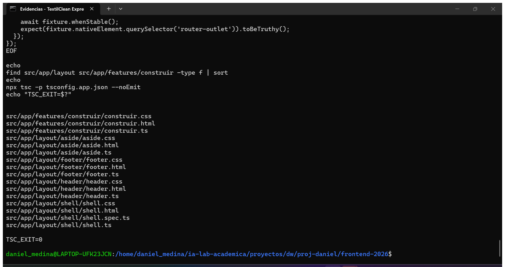

---

## 2.7 · `HttpClient` en `app.config.ts`

### Qué se hace

Registrar `provideHttpClient()` **sin interceptores**. Los interceptores de
sesión y de errores llegan en ISS-08, cuando exista el módulo de autenticación.

### Código

```ts
// src/app/app.config.ts (extracto)
import { provideHttpClient } from '@angular/common/http';

export const appConfig: ApplicationConfig = {
  providers: [
    provideBrowserGlobalErrorListeners(),

    // HttpClient sin interceptores: los servicios ya estan listos.
    // ISS-08 agrega authInterceptor y errorInterceptor junto con la sesion.
    provideHttpClient(),

    provideRouter(
      routes,
      withComponentInputBinding(),
      withInMemoryScrolling({ scrollPositionRestoration: 'top' }),
    ),

    providePrimeNG({
      license: environment.primeUiLicense || undefined,
      ripple: true,
      inputVariant: 'outlined',
      theme: {
        preset: Aura,
        options: {
          darkModeSelector: '.app-dark',
          cssLayer: { name: 'primeng', order: 'theme, base, primeng, utilities' },
        },
      },
    }),

    MessageService,
    ConfirmationService,
  ],
};
```

### Resultado esperado

```
provideHttpClient agregado: True
24:    provideHttpClient(),
TSC_EXIT=0
```

### Evidencia

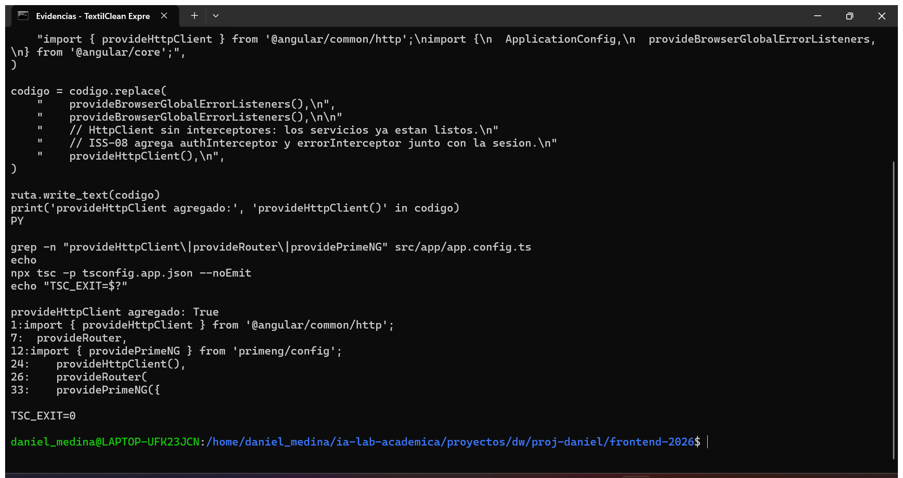

---

## 2.8 · Verificación: build de producción

```bash
npm run build
```

```
Initial chunk files | Names         |  Raw size | Estimated transfer size
chunk-M6CEUXVL.js   | -             | 389.37 kB |               102.27 kB
main-WHXBKGT5.js    | main          | 319.06 kB |                54.60 kB
styles-RSQTZTDO.css | styles        |  27.35 kB |                 5.34 kB

                    | Initial total | 735.78 kB |               162.21 kB

Lazy chunk files    | Names         |  Raw size | Estimated transfer size
chunk-GMGYAN5V.js   | construir     |  43.02 kB |                 9.26 kB

Application bundle generation complete. [7.508 seconds]
BUILD_EXIT=0
```

`construir` sale como _lazy chunk_ porque la ruta usa `loadComponent`, no
`component`. El presupuesto de `initial` es 750 kB: quedamos 14 kB por debajo.

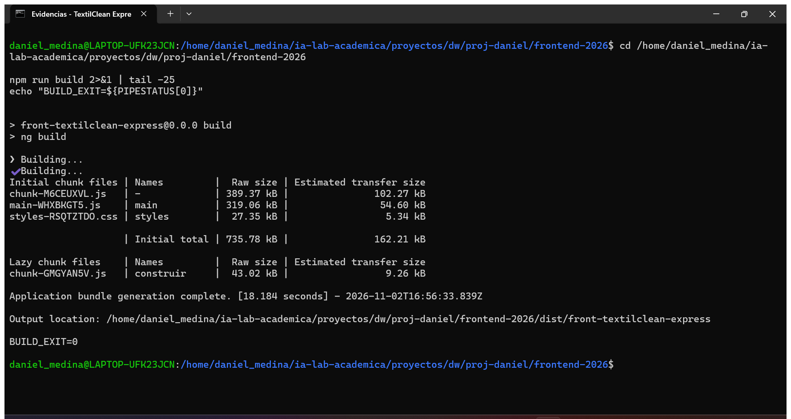

---

## 2.9 · Verificación: pruebas unitarias

```bash
npm test -- --watch=false
```

```
 ✓ src/app/demo/ejemplo/ejemplo.spec.ts (4 tests)
 ✓ src/app/layout/shell/shell.spec.ts (2 tests)

 Test Files  7 passed (7)
      Tests  19 passed (19)
   Duration  17.10s
TEST_EXIT=0
```

| Archivo de prueba                         | Casos | Qué cubre                                            |
| ----------------------------------------- | ----- | ---------------------------------------------------- |
| `app.spec.ts`                             | 2     | `App` se crea y renderiza `<router-outlet />`        |
| `demo/ejemplo/ejemplo.spec.ts`            | 4     | signals, `+1000`, reinicio (heredado de ISS-01)      |
| `features/clients/client-api.spec.ts`     | 2     | desenvuelve `{ clients }` y usa `environment.apiUrl` |
| `core/utils/api-error.spec.ts`            | 5     | status 0, `{error, detail}`, 403, string, `Error`    |
| `core/utils/media-query.spec.ts`          | 2     | sin `matchMedia` → `false`; sigue cambios            |
| `shared/ui/status-tag/status-tag.spec.ts` | 2     | `active`/`inactive` → etiqueta y severidad           |
| `layout/shell/shell.spec.ts`              | 2     | layout único y apertura del Drawer                   |

> El plan del curso hablaba de «8 archivos y 33 casos» porque incluía las pruebas
> de ISS-01B. Aquí ISS-01B no existió: los números reales son **7 archivos y 19
> casos**.

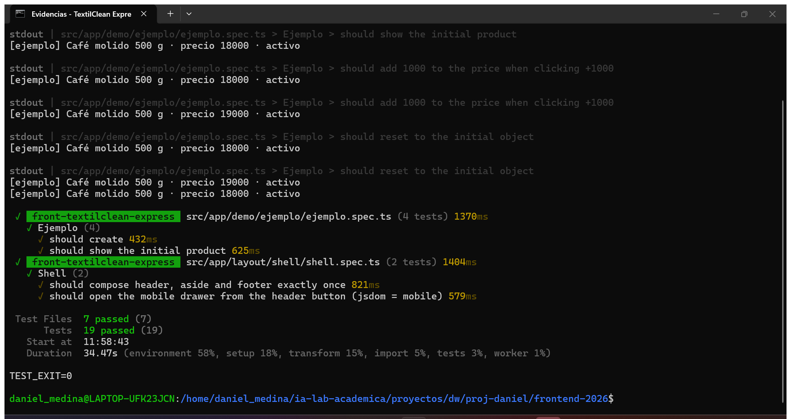

---

## 2.10 · Servidor de desarrollo

```bash
npm start > ~/.opencode-term/ng-serve.log 2>&1 &
sleep 40
tail -12 ~/.opencode-term/ng-serve.log
curl -s -o /dev/null -w "HTTP %{http_code}\n" http://localhost:4200
```

```
Application bundle generation complete. [14.725 seconds]
Watch mode enabled. Watching for file changes.
➜  Local:   http://localhost:4200/
HTTP 200
```

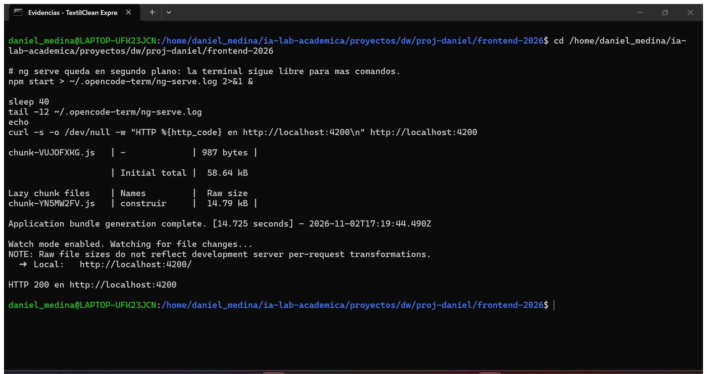

---

## 2.11 · Pantalla del Shell

`http://localhost:4200` redirige a `/construir` dentro del Shell: Header con el
botón de menú, Aside con los cinco módulos, la tarjeta de prototipo y el Footer.

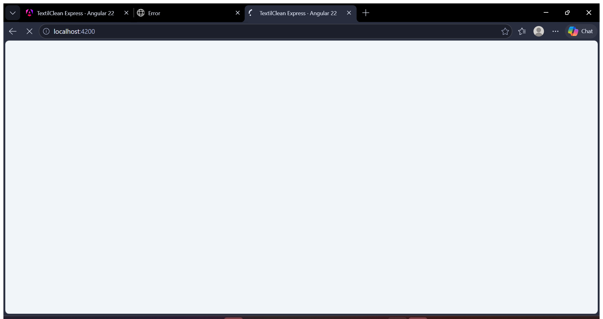

---

## Problemas encontrados en ISS-02

| Síntoma                                                             | Causa                                                   | Solución                                         |
| ------------------------------------------------------------------- | ------------------------------------------------------- | ------------------------------------------------ |
| `TS2305: Module './api.model' has no exported member 'HttpMethod'`  | `HttpMethod` se definió en `resource.model.ts`          | importar desde `./resource.model`                |
| `FIFO sin lector` al enviar comandos                                | la ventana de evidencias se cerró (o WSL se reinició)   | relanzar `term-evidencias.bat`                   |
| `cat: ~/.opencode-term/blocks/x.sh: No such file`                   | `~` no se expande dentro de comillas en `RUNFILE`       | enviar siempre rutas absolutas                   |
| `Wsl/Service/0x8007274c` al abrir el navegador                      | poca memoria libre en la VM                             | `wsl --shutdown`, relanzar terminal y `ng serve` |
| `npm start` falla con `CMD.EXE … rutas UNC` o `"ng" no se reconoce` | el PATH heredaba los binarios de Windows (`/mnt/c/...`) | `term.sh` carga `nvm` y filtra `/mnt/c` del PATH |

---

## Estado de las ISS

| ISS     | Criterios  | Estado                                                   |
| ------- | ---------- | -------------------------------------------------------- |
| ISS-00  | 0.1 – 0.6  | ✅ verificado                                            |
| ISS-01  | 1.1 – 1.9  | ✅ build `0`, 7/7 pruebas, `4200` → `200`, 5 capturas    |
| ISS-01A | —          | pendiente                                                |
| ISS-01B | —          | pendiente                                                |
| ISS-02  | 2.1 – 2.11 | ✅ build `0`, 19/19 pruebas, `4200` → `200`, 12 capturas |

---

## Índice de evidencias

| Archivo                               | ISS | Bloque                              |
| ------------------------------------- | --- | ----------------------------------- |
| `iss-01-01-ng-version-estructura.png` | 01  | 1.1 versiones + estructura          |
| `iss-01-02-primeng.png`               | 01  | 1.2 `npm ls` PrimeNG                |
| `iss-01-03-build.png`                 | 01  | 1.8 `npm run build`                 |
| `iss-01-04-test.png`                  | 01  | 1.8 `ng test`                       |
| `iss-01-05-pantalla.png`              | 01  | 1.8 app en `:4200`                  |
| `iss-02-01-entornos.png`              | 02  | 2.1 entornos + `angular.json`       |
| `iss-02-02-modelos.png`               | 02  | 2.2 13 modelos                      |
| `iss-02-03-servicios-api.png`         | 02  | 2.3 10 servicios                    |
| `iss-02-04-utilidades.png`            | 02  | 2.4 utilidades + pruebas            |
| `iss-02-05-componentes-ui.png`        | 02  | 2.5 componentes compartidos         |
| `iss-02-05b-correccion-tsc.png`       | 02  | 2.5 corrección `HttpMethod` + `tsc` |
| `iss-02-06-layout-shell.png`          | 02  | 2.6 layout, Shell y rutas           |
| `iss-02-07-httpclient.png`            | 02  | 2.7 `provideHttpClient()`           |
| `iss-02-08-build.png`                 | 02  | 2.8 `npm run build`                 |
| `iss-02-09-test.png`                  | 02  | 2.9 `npm test`                      |
| `iss-02-10-serve.png`                 | 02  | 2.10 `ng serve` + `200`             |
| `iss-02-11-pantalla.png`              | 02  | 2.11 Shell en el navegador          |

> ISS-00 se verificó sin capturas: el detalle está en
> [`iss-00-verificacion.md`](iss-00-verificacion.md).

---

## Problemas encontrados y soluciones

| Síntoma                                                    | Causa                                                        | Solución                                                |
| ---------------------------------------------------------- | ------------------------------------------------------------ | ------------------------------------------------------- |
| `ng` abre un editor / `panic: terminal initialize failure` | `/usr/bin/ng` (editor Debian) gana en shells no interactivos | cargar `nvm` desde `~/.profile`                         |
| `ng new .` falla                                           | `.` no es nombre npm válido                                  | `ng new <nombre> --directory .`                         |
| WSL deja de aceptar shells (`0x8007274c`)                  | VM de WSL bloqueada, poca memoria                            | `wsl --shutdown` y relanzar backend y `ng serve`        |
| `[PrimeUI] No license key configured`                      | falta la clave Community                                     | aviso esperado; pegar la clave en `environment*.ts`     |
| 401 en Swagger con token válido                            | token expirado (900 s) o `Bearer` duplicado                  | volver a hacer login y pegar solo `eyJ...` en Authorize |
